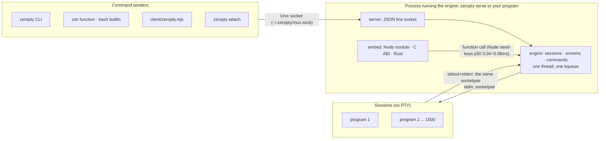
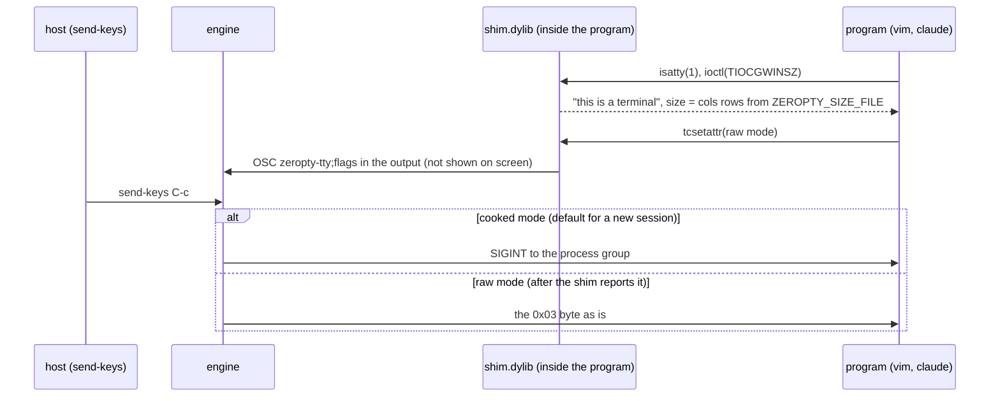
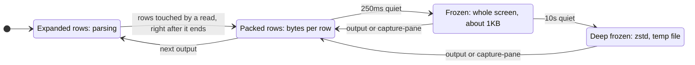
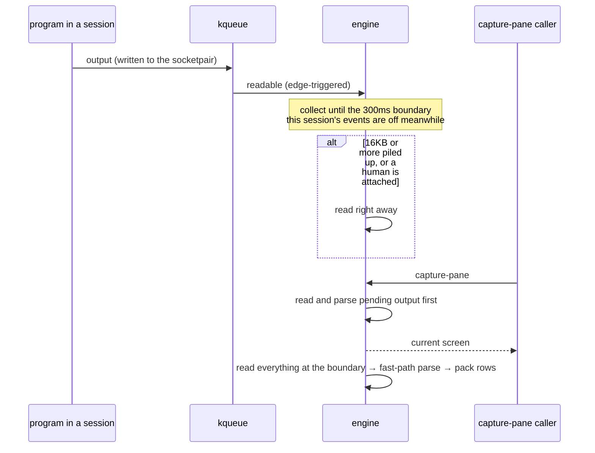
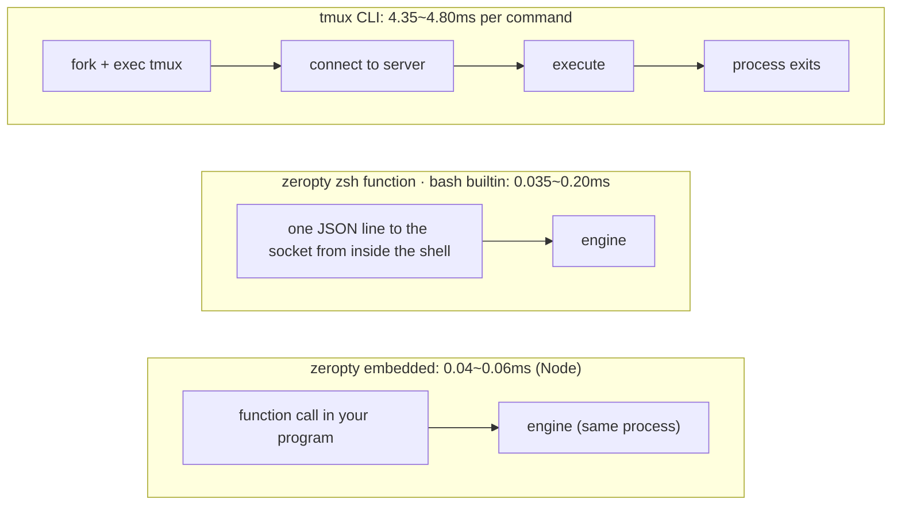

# Design: how we got to 10x

**English** · [한국어](ko/DESIGN.md)

[README](../README.md) · [Docs](README.md) · [Usage](USAGE.md) · [Plugins](PLUGINS.md) · [FAQ](FAQ.md) · [Benchmarks](BENCHMARKS.md) · [Design](DESIGN.md) · [Versioning](VERSIONING.md) · [Releasing](RELEASING.md)

**In one line: we exploit the fact that most of 1000 sessions are quiet.** Quiet screens are folded away so they use almost no memory, and busy screens batch their work so there is less of it. The numbers below were measured by turning each technique on and off, and the same evidence is recorded in the code comments.

- [Overall architecture](#overall-architecture)
- [1. Sockets instead of PTYs](#1-sockets-instead-of-ptys)
- [2. A small screen structure](#2-a-small-screen-structure)
- [3. Folding screens away (memory)](#3-folding-screens-away-memory)
- [4. Doing less work by batching it (CPU)](#4-doing-less-work-by-batching-it-cpu)
- [5. Not starting processes (latency)](#5-not-starting-processes-latency)
- [6. Only measurements decide](#6-only-measurements-decide)
- [Code map](#code-map)

Diagrams: [overall architecture](#overall-architecture) · [the shim and the line discipline](#1-sockets-instead-of-ptys) · [cell layout](#2-a-small-screen-structure) · [screen state transitions](#3-folding-screens-away-memory) · [output batching and the flush before capture](#4-doing-less-work-by-batching-it-cpu) · [how a command reaches the engine](#5-not-starting-processes-latency)

## Overall architecture

One engine owns every session. Depending on who runs the engine, it is either a standalone server (`zeropty serve`) or a library inside your own program. Either way, the command format is the same as tmux.



- A **session** is a process group launched with `/bin/sh -c command`. Its terminal is a single socketpair: stdin, stdout and stderr are all its one end, as they are one PTY under tmux.
- For **programs that need a terminal**, `zeropty-tty` injects a shim with `DYLD_INSERT_LIBRARIES` so the socket looks like a terminal.
- **Plugins** listen to session events and add commands. Separate processes attached over the socket, C libraries launched with `plugin-run` and callbacks inside the host process all go through the same registry ([PLUGINS.md](PLUGINS.md)).
- The **engine** waits on a single kqueue for every session's output, process exits and timers. If the host registers its own fds on the same kqueue (`Engine::watch`, with `HOST_TAG` in the tag), a single event loop is all you need.

## 1. Sockets instead of PTYs

tmux opens one PTY per window and so runs into the macOS PTY limit (511 by default, 999 at most). zeropty connects sessions with socket pairs, so there is no such limit. claude gets `shim.dylib` injected so it sees a terminal (the `claude-zeropty` wrapper). The shim intercepts `isatty`, `tcgetattr`, `ioctl(TIOCGWINSZ)`, `readpassphrase` and others.

What the PTY used to do (turning Enter into a newline, `C-c` into a signal, line editing, echo), the engine emulates when it sends keys. The same keys were checked against tmux ([Usage: line discipline](USAGE.md#key-input-and-the-line-discipline)).

When a program changes the terminal mode, the shim slips that fact into the output stream. So the engine knows exactly from which point "from now on" keys must be handled differently.



When the window size changes (a human `attach`es from a terminal of a different size), the engine rewrites the size file and sends SIGWINCH. The shim reads that file every time it is asked.

## 2. A small screen structure

We wrote our own screen parser and check that it produces the same results as the `vt100` crate, using recorded claude sessions and thousands of sets of random input.

- A cell is 6 bytes (32 bytes in the `vt100` crate). Halving the cell size also halved CPU under load: with hundreds of sessions, every cell write is a cache miss.
- A row holds cells only up to its last non-empty column. Empty space costs nothing.

```text
Cell (6 bytes, packed)
┌───────────────────────────────┬──────────────────┐
│ ch: u32                       │ attr: u16        │
│ code point + wide-char flag   │ palette index    │
│ (intern id if >1 code point)  │ (color + font)   │
└───────────────────────────────┴──────────────────┘
```

## 3. Folding screens away (memory)

The longer a screen stays quiet, the smaller the form it is folded into; when output arrives or someone reads it, it unfolds again.



- **Packed rows.** When a read finishes, the rows it touched are packed immediately (1 byte per ASCII character, repeated cells stored once). Even on a busy screen, only the row currently being parsed stays expanded.
- **Freezing.** After 250ms of quiet, the whole screen is frozen into a single chunk of bytes. One claude screen goes from tens of KB to about 1KB. For sessions that print often, the wait grows up to 800ms so they don't keep freezing and thawing (with 400 sessions, growing it up to 4 seconds gave 3.3MB, 800ms gave 2.1MB, with the same CPU).
- **Deep freezing.** After more than 10 seconds of quiet, the chunk is compressed again with zstd (to about half). These chunks are gathered in one unnamed temporary file, so they don't count against process memory. When each was allocated separately, 0.3MB of data for 400 sessions took up 0.84MB.
- **Taming the allocator.** We use mimalloc v2 and return freed pages to the OS right away. With 400 busy claude sessions, v3 used 4.5MB and v2 3.5MB. Without returning pages, 400 idle sessions kept holding the 1.3MB they used while parsing. Buffers that are rebuilt often reuse a single chunk (fragmentation had cost 8.6KB per session; it dropped to about the 2.6KB of actual data).

## 4. Doing less work by batching it (CPU)

This is the path one piece of output takes to reach the screen. Reads are deferred, but whoever reads the screen never waits.



- **One thread and one kqueue handle every session.** There is no thread or process per session.
- **Batched reads.** Output is not read the moment it arrives; it is collected until a 300ms boundary and read all at once. Sessions that wake at the same moment are handled in a single wakeup. With 400 claude sessions, CPU was 5.2% at 100ms and 3.7% at 300ms. In exchange, `capture-pane` reads the piled-up output first and then answers, so readers of the screen never see stale data. If a human is attached, or the pipe fills up (16KB), output is read immediately.
- **Fast paths.** Runs of ASCII, runs of UTF-8 (claude's borders, Korean text) and complete CSI sequences, which make up most output, are written straight to the screen without going through the general parser. The ASCII fast path alone halved the parsing cost.
- **The output channel is a socketpair, not a pipe.** Once about 250 macOS pipes have grown, the rest are stuck at 512 bytes, and with 1000 sessions 41% of the output was stuck inside the programs. Giving each session its own 64KB socket buffer lets everything flow.
- **Bulk output is parsed after it has all arrived.** When the pipe fills, everything is read first until the program stops. The time for 5.4MB of output to finish went from 17ms to \~3ms.
- **Rows that will be discarded are not packed.** Rows scrolling off the screen are packed together when the write ends, and rows pushed out of the scrollback in the meantime are discarded without packing. Parsing 5.4MB went from 16.5ms to about 9ms.

## 5. Not starting processes (latency)

Most of the cost of a single command is process startup (1.3ms even for an empty C program).

| How the command is sent | Work per command | Time per command |
|---|---|---|
| tmux CLI | start process → connect to server → execute → process exits | 4.35\~4.80ms |
| zeropty zsh function | connect to the socket from inside the shell, one line of JSON (no process) | 0.11\~0.20ms |
| zeropty bash builtin | connect to the socket from inside the shell, one line of JSON (no process) | 0.035\~0.115ms |
| zeropty embedded | function call | 0.04\~0.06ms in Node (`send-keys` p50) |



- **Socket.** One connection carries many commands (the Node client).
- **Embedded.** Putting the engine inside your process turns commands into function calls. In Node, one `send-keys` takes p50 0.04\~0.06ms and `capture-pane` 0.06\~0.07ms (busy session 0.09\~0.12ms). Most of that time is the idle Node thread waking up (\~40\~50µs); called back to back without idling, it is 2.6µs per call ([BENCHMARKS](BENCHMARKS.md)). With no server process, there is also no floor of one empty process's memory (0.865MB). If even the engine thread is dropped and the host's event loop drives the engine (polled), 200 idle sessions go from 0.66\~0.69MB to 0.31MB. Commands like `capture-pane` with nothing to read, or `send-keys`, are handled right on the calling thread without waking the engine thread.
- **zsh function, bash builtin.** zsh uses its built-in socket module, and bash a C function loaded with `enable -f`, to talk to the server directly from inside the shell. A tmux command's 4.35\~4.80ms becomes 0.11\~0.20ms in zsh and 0.035\~0.115ms in bash (`has-session` and `send-keys`, zsh at p50; a 2000-line `capture-pane` is 0.45\~0.48ms in zsh and 0.095\~0.102ms in bash).

## 6. Only measurements decide

Every change was measured interleaved with tmux, and its cause confirmed with a profiler, before it went in. Several "obvious" causes (kernel time, repeated freezing, the allocator) turned out wrong, and a profile or a counter showed the real one.

Techniques whose benefit exists only on paper (putting the heap in a file: the footprint shrinks but RAM use stays the same, and it adds 10MB of disk writes per minute) were left out. So were techniques that only raise benchmark scores. The "claude history dump" workload is a synthetic load that resends the same 15KB unchanged every 2 seconds, but when a real claude recording (40 seconds) is split into 300ms reads, the same output repeats 0% of the time. So "skip redraws that don't change the screen" would raise only this workload's CPU multiplier (10.2\~11.9×) and do nothing for real use, and it was left out.

Methodology and every number: [Benchmarks](BENCHMARKS.md)

## Code map

| File | What it does |
|---|---|
| `src/term/` | Screen parser (6-byte cells, packed rows, freezing, deep freezing). Line-for-line the same meaning as the `vt100` crate. Pure code with no I/O |
| `src/sys/` | The OS boundary: kqueue, fds, processes, time, the attaching person's terminal (`zeropty::tty`). libc I/O is called only from here |
| `src/engine/` | The engine: sessions, every command (the `COMMANDS` table in `commands.rs`), `wait-pane`, attach, moving sessions (`handover.rs`). It touches the OS only through the `Poller`, `Clock` and `Programs` traits, so it is unit-tested with fakes |
| `src/protocol.rs` | Bytes on the socket: request and answer lines, attach frames. Shared by the server and the CLI |
| `src/server.rs` | Socket server: clients, `attach`, `wait-pane`, session handover. Borrows the engine |
| `src/host.rs` | The order of one turn of the host loop (events → reads → attach output and plugins → filter changes). Shared by every host |
| `src/embed.rs` | The engine inside a host: on its own thread (`Embedded`) or on the host loop (`Polled`). Bindings call it only through the `Frontend` trait |
| `src/plugin.rs`, `src/plugin/` | Plugins ([PLUGINS.md](PLUGINS.md)): the registry (`Plugins`) is a `host::Service` that runs after the server. The engine collects only the kinds of session events plugins asked for. With no plugins, it costs one atomic read per command |
| `src/main.rs`, `src/cli/` | The `zeropty` program: standalone server, CLI, attach, `plugin-run`, `--help`, `--version` |
| `shim/shim.c` | The shim that intercepts `isatty` and friends |
| `bindings/c`, `bindings/node` | C ABI (`zeropty.h`) and Node module (N-API) |
| `client/` | Node clients (`zeropty.mjs` for the server, `embedded.mjs` for embedded) |
| `shell/` | zsh function, bash builtin |
| `tests/` | `vt100` comparison (recordings + random), server, embedded, moving sessions |
| `bench/` | Benchmark scripts |

What each layer is responsible for and which invariants it keeps is documented in each module's `//!` docs (rustdoc). Rust API docs: [Docs](README.md#rust-api-docs).
