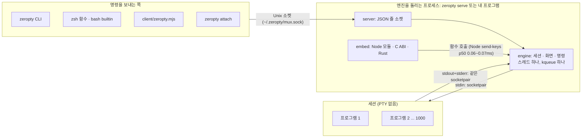
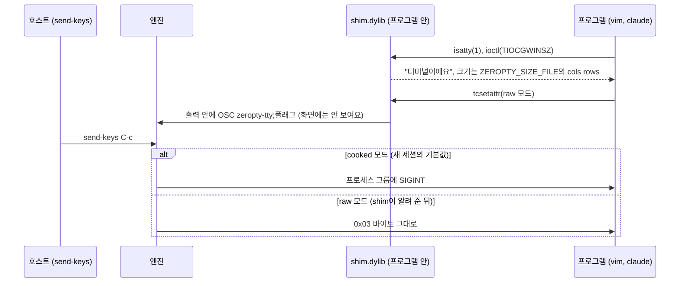
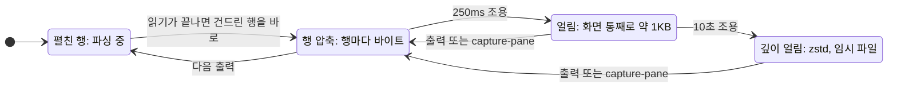
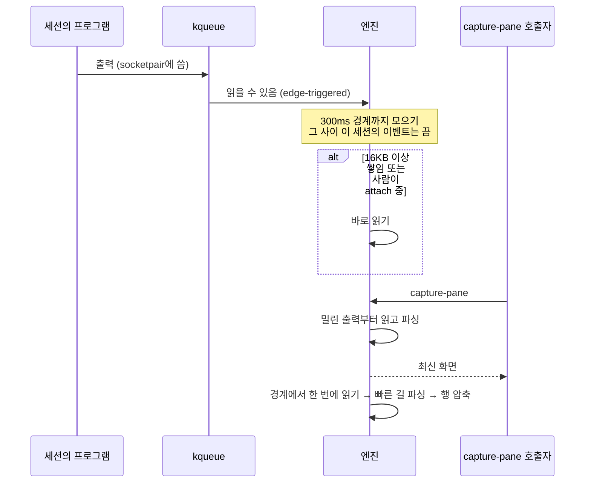
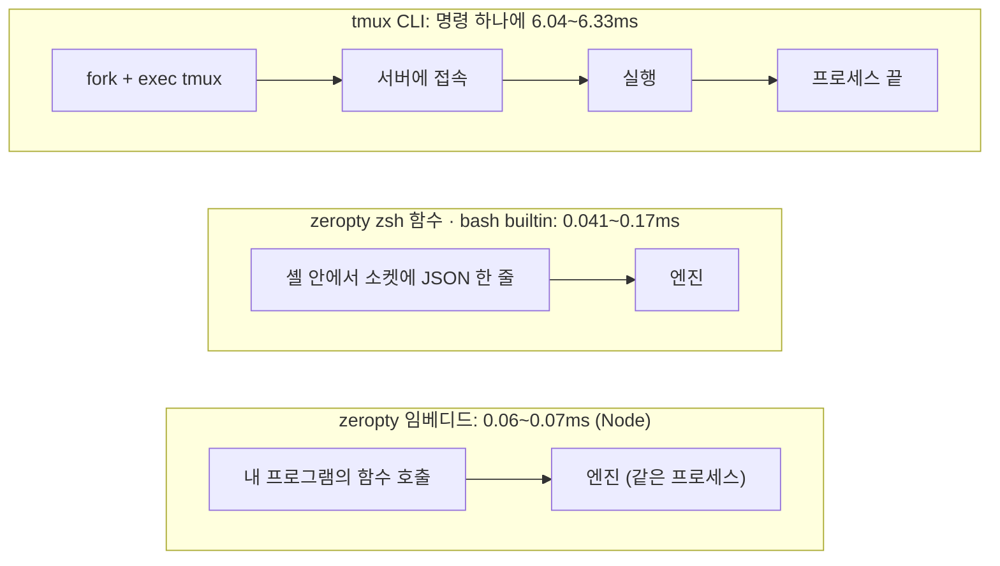

# 설계: 어떻게 10배를 만들었나

[English](../DESIGN.md) · **한국어**

[README](../../README.ko.md) · [문서 목록](README.md) · [사용법](USAGE.md) · [플러그인](PLUGINS.md) · [FAQ](FAQ.md) · [벤치마크](BENCHMARKS.md) · [설계](DESIGN.md) · [버전 정책](VERSIONING.md) · [릴리스](RELEASING.md)

**한 줄 요약: 1000개 중 대부분은 조용하다는 점을 이용했어요.** 조용한 화면은 거의 메모리를 안 쓰게 접어 두고, 바쁜 화면은 일을 묶어서 적게 해요. 아래 수치는 각 기법을 넣고 뺄 때 잰 값이고, 코드 주석에도 같은 근거를 남겨 두었어요.

- [전체 구조](#전체-구조)
- [1. PTY 대신 소켓](#1-pty-대신-소켓)
- [2. 작은 화면 구조](#2-작은-화면-구조)
- [3. 화면을 접어 두기 (메모리)](#3-화면을-접어-두기-메모리)
- [4. 일을 묶어서 적게 (CPU)](#4-일을-묶어서-적게-cpu)
- [5. 프로세스를 띄우지 않기 (응답 속도)](#5-프로세스를-띄우지-않기-응답-속도)
- [6. 측정으로만 결정](#6-측정으로만-결정)
- [코드 지도](#코드-지도)

그림: [전체 구조](#전체-구조) · [shim과 라인 디시플린](#1-pty-대신-소켓) · [셀 구조](#2-작은-화면-구조) · [화면 상태 전이](#3-화면을-접어-두기-메모리) · [출력 묶기와 capture 직전 flush](#4-일을-묶어서-적게-cpu) · [명령이 엔진까지 가는 길](#5-프로세스를-띄우지-않기-응답-속도)

## 전체 구조

엔진 하나가 모든 세션을 가져요. 엔진을 누가 돌리느냐에 따라 독립 서버(`zeropty serve`)가 되기도 하고, 내 프로그램 안의 라이브러리가 되기도 해요. 어느 쪽이든 명령 형식은 tmux와 같아요.



- **세션**은 `/bin/sh -c 명령`으로 띄운 프로세스 그룹이에요. 터미널은 socketpair 하나예요. stdin, stdout, stderr가 모두 그 한쪽 끝이에요(tmux에서 PTY 하나인 것처럼).
- **터미널이 필요한 프로그램**은 `zeropty-tty`가 `DYLD_INSERT_LIBRARIES`로 shim을 넣어서 소켓을 터미널로 보이게 해요.
- **플러그인**은 세션 이벤트를 듣고 명령을 더해요. 소켓으로 붙는 별도 프로세스, `plugin-run`으로 띄운 C 라이브러리, 호스트 프로세스 안의 콜백 모두 같은 등록부를 거쳐요([PLUGINS.md](PLUGINS.md)).
- **엔진**은 kqueue 하나로 모든 세션의 출력, 프로세스 종료, 타이머를 기다려요. 호스트가 자기 fd를 같은 kqueue에 올려 두면(`Engine::watch`, 태그에 `HOST_TAG`) 이벤트 루프도 하나로 끝나요.

## 1. PTY 대신 소켓

tmux는 창마다 PTY를 하나씩 열어서 macOS의 PTY 한도(기본 511개, 최대 999개)에 걸려요. zeropty는 세션을 socketpair로 연결해서 한도가 없어요. claude에는 `shim.dylib`을 넣어 터미널로 보이게 해요(`claude-zeropty` 래퍼). `isatty`, `tcgetattr`, `ioctl(TIOCGWINSZ)`, `tcsetpgrp`, `readpassphrase`, `getpass` 등을 가로채요.

PTY가 해 주던 일(Enter를 줄바꿈으로, `C-c`를 시그널로, 줄 편집, 에코)은 엔진이 키를 보낼 때 흉내 내요. 같은 키를 tmux와 대조했어요([사용법: 라인 디시플린](USAGE.md#키-입력과-라인-디시플린)).

프로그램이 터미널 모드를 바꾸면 shim이 그 사실을 출력 안에 끼워 보내요. 그래서 엔진은 "지금부터" 키를 어떻게 다룰지 정확히 그 지점부터 알아요.



창 크기가 바뀌면(사람이 다른 크기의 터미널로 `attach`) 엔진이 크기 파일을 다시 쓰고 SIGWINCH를 보내요. shim은 물어볼 때마다 그 파일을 읽어요.

## 2. 작은 화면 구조

화면 해석기를 직접 만들고, `vt100` crate와 같은 결과를 내는지 녹화한 claude 세션과 무작위 입력 수천 세트로 대조해요.

- 셀 하나가 6바이트예요(`vt100` crate는 32바이트). 셀 크기를 반으로 줄이자 부하 상태의 CPU도 반이 됐어요. 세션이 수백 개면 셀 쓰기가 곧 캐시 미스이기 때문이에요.
- 행은 마지막으로 내용이 있는 칸까지만 셀을 가져요. 빈 공간은 비용이 0이에요.

```text
Cell (6바이트, packed)
┌───────────────────────────────┬───────────────┐
│ ch: u32                       │ attr: u16     │
│ 코드 포인트 + 넓은 글자 플래그  │ 팔레트 번호    │
│ (여러 코드 포인트면 intern id) │ (색·글꼴 묶음) │
└───────────────────────────────┴───────────────┘
```

## 3. 화면을 접어 두기 (메모리)

화면은 조용한 시간에 따라 점점 더 작은 형태로 바뀌고, 출력이 오거나 누가 읽으면 다시 펼쳐져요.



- **행 압축.** 읽기가 끝나면 그 읽기가 건드린 행을 바로 압축해요(ASCII 한 글자에 1바이트, 같은 칸 반복은 한 번에). 바쁜 화면도 지금 파싱 중인 행만 펼쳐 둬요.
- **얼리기.** 250ms 조용하면 화면 전체를 바이트 덩어리로 얼려요. claude 화면 하나가 수십 KB에서 약 1KB가 돼요. 자주 출력하는 세션은 기다리는 시간을 최대 800ms까지 늘려, 얼렸다 녹이기를 반복하지 않게 해요(400개 기준 4초까지 늘릴 때 3.3MB, 800ms에서 2.1MB, CPU는 같음).
- **깊이 얼리기.** 10초 넘게 조용하면 zstd로 한 번 더 압축해요(약 절반). 이 덩어리들은 이름 없는 임시 파일 하나에 모아 둬서 프로세스 메모리에 잡히지 않아요. 각자 따로 할당했을 때는 400개 기준 0.3MB 데이터에 0.84MB를 차지했어요.
- **할당기 길들이기.** mimalloc v2를 쓰고 해제한 페이지를 바로 OS에 돌려줘요. 400개 바쁜 claude 세션 기준으로 v3는 4.5MB, v2는 3.5MB였어요. 돌려주지 않으면 대기 400개가 파싱 때의 1.3MB를 계속 쥐고 있었어요. 자주 다시 만드는 버퍼는 한 덩어리를 재사용해요(파편화로 세션당 8.6KB를 쓰던 게 데이터 2.6KB 수준으로 줄었어요).

## 4. 일을 묶어서 적게 (CPU)

출력 하나가 화면에 반영되기까지의 길이에요. 읽기를 미루되, 화면을 읽는 쪽은 절대 기다리지 않게 했어요.



- **스레드 하나, kqueue 하나로 모든 세션을 처리해요.** 세션마다 스레드나 프로세스를 두지 않아요.
- **읽기 모으기.** 출력이 오면 바로 읽지 않고 300ms 경계까지 모았다가 한 번에 읽어요. 같은 순간에 깨어난 세션들도 한 번의 깨어남으로 처리해요. 400개 claude 기준 100ms에서는 CPU 5.2%, 300ms에서는 3.7%였어요. 대신 `capture-pane`은 쌓인 출력을 먼저 읽고 답해서, 화면을 읽는 쪽에는 늦는 일이 없어요. 사람이 붙어 보고 있거나 파이프가 차면(16KB) 바로 읽어요.
- **빠른 길.** 출력의 대부분인 ASCII 연속 구간, UTF-8 연속 구간(claude의 테두리, 한글), 완결된 CSI 시퀀스는 범용 파서를 거치지 않고 바로 화면에 써요. ASCII 빠른 길만으로 파싱 비용이 반이 됐어요.
- **출력 통로는 파이프가 아니라 socketpair.** macOS 파이프는 약 250개가 커지면 나머지가 512바이트로 묶여서, 세션 1000개에서 출력의 41%가 프로그램 안에 묶여 있었어요. 세션마다 64KB 소켓 버퍼를 따로 주자 다 흘러요.
- **대량 출력은 다 받고 나서 파싱.** 파이프가 차면 프로그램이 멈출 때까지 전부 먼저 읽어요. 5.4MB 출력이 끝나는 시간이 17ms에서 \~3ms가 됐어요.
- **버려질 행은 압축하지 않기.** 스크롤되어 나가는 행은 쓰기가 끝날 때 한꺼번에 압축하고, 그 사이 스크롤백에서 밀려난 행은 압축 없이 버려요. 5.4MB 파싱이 16.5ms에서 약 9ms가 됐어요.

## 5. 프로세스를 띄우지 않기 (응답 속도)

명령 하나의 비용은 대부분 프로세스 시작(빈 C 프로그램도 1.3ms)이에요.

| 명령을 보내는 길 | 명령 하나에 드는 일 | 명령 하나의 시간 |
|---|---|---|
| tmux CLI | 프로세스 시작 → 서버 접속 → 실행 → 프로세스 끝 | 6.04\~6.33ms |
| zeropty zsh 함수 | 셸 안에서 소켓에 접속해 JSON 한 줄 (프로세스 없음) | 0.11\~0.17ms |
| zeropty bash builtin | 셸 안에서 소켓에 접속해 JSON 한 줄 (프로세스 없음) | 0.041\~0.075ms |
| zeropty 임베디드 | 함수 호출 | Node에서 0.06\~0.07ms (`send-keys` p50) |



- **소켓.** 한 연결로 여러 명령을 보내요(Node 클라이언트).
- **임베디드.** 엔진을 내 프로세스 안에 넣으면 명령이 함수 호출이 돼요. Node에서 `send-keys` 한 번이 p50 0.06\~0.07ms, `capture-pane`이 0.06\~0.07ms(바쁜 세션 0.10\~0.17ms)예요. 이 시간의 대부분은 쉬던 Node 스레드가 깨는 시간(\~40\~50µs)이고, 쉬지 않고 연달아 부르면 한 번에 2.6µs예요([BENCHMARKS](BENCHMARKS.md)). 서버 프로세스가 없으니 빈 프로세스 하나의 메모리(0.865MB) 하한도 없어요. 엔진 스레드조차 없이 호스트의 이벤트 루프가 엔진을 돌리게 하면(polled) 대기 200개가 0.68\~0.69MB에서 0.39MB가 돼요. 읽을 게 없는 `capture-pane`, `send-keys` 같은 명령은 엔진 스레드를 깨우지 않고 부른 스레드에서 바로 처리해요.
- **zsh 함수, bash builtin.** zsh는 기본 소켓 모듈로, bash는 `enable -f`로 넣는 C 함수로 셸 안에서 서버에 바로 말해요. tmux 명령 6.04\~6.33ms가 zsh 0.11\~0.17ms, bash 0.041\~0.075ms가 돼요(`has-session`·`send-keys`, zsh는 p50. 2000줄 `capture-pane`은 zsh 0.50\~0.55ms, bash 0.114\~0.138ms).

## 6. 측정으로만 결정

매 변경을 tmux와 번갈아 측정하고 프로파일로 원인을 확인한 뒤 넣었어요. "당연해 보이는" 원인 여러 개(커널 시간, 얼리기 반복, 할당기)가 틀렸고, 프로파일이나 카운터가 실제 원인을 보여 줬어요.

효과가 장부상으로만 있는 기법(힙을 파일에 두기: footprint는 줄지만 RAM에는 그대로이고 디스크 쓰기가 분당 10MB 생김)은 넣지 않았어요. 벤치마크 점수만 올리는 기법도 넣지 않았어요. "claude 기록 통째 출력" 부하는 같은 15KB를 2초마다 그대로 다시 보내는 합성 부하인데, 실제 claude 녹화(40초)를 300ms 읽기로 나누면 같은 출력이 반복되는 경우가 0%예요. 그래서 "화면이 안 바뀌는 다시 그리기 건너뛰기"는 이 부하의 CPU 배수(10.2\~11.9×)만 올리고 실제 사용에는 효과가 없어 넣지 않았어요.

측정 방법과 모든 수치: [벤치마크](BENCHMARKS.md)

## 코드 지도

| 파일 | 하는 일 |
|---|---|
| `src/term/` | 화면 해석기(6바이트 셀, 행 압축, 얼리기, 깊이 얼리기). `vt100` crate와 줄 단위로 같은 의미. I/O 없는 순수 코드 |
| `src/sys/` | OS 경계: kqueue, fd, 프로세스, 시간, 붙는 사람의 터미널(`zeropty::tty`). libc 입출력은 여기에서만 불러요 |
| `src/engine/` | 엔진: 세션, 모든 명령(`commands.rs`의 `COMMANDS` 표), `wait-pane`, attach, 세션 옮기기(`handover.rs`). OS와는 `Poller`·`Clock`·`Programs` 트레이트로만 닿아서 가짜로 단위 테스트해요 |
| `src/protocol.rs` | 소켓 위의 바이트: 요청·답 줄, attach 프레임. 서버와 CLI가 같이 써요 |
| `src/server.rs` | 소켓 서버: 클라이언트, `attach`, `wait-pane`, 세션 넘기기. 엔진을 빌려 써요 |
| `src/host.rs` | 호스트 루프 한 바퀴(이벤트 → 읽기 → attach 출력·플러그인 → 필터 변경)의 순서. 모든 호스트가 같이 써요 |
| `src/embed.rs` | 호스트 안의 엔진: 자기 스레드(`Embedded`) 또는 호스트 루프(`Polled`). 바인딩은 `Frontend` 트레이트로만 불러요 |
| `src/plugin.rs`, `src/plugin/` | 플러그인([PLUGINS.md](PLUGINS.md)): 등록부(`Plugins`)는 서버 다음에 도는 `host::Service`예요. 엔진은 플러그인이 원한 종류의 세션 이벤트만 모아요. 플러그인이 없으면 명령마다 원자적 읽기 한 번 |
| `src/main.rs`, `src/cli/` | `zeropty` 프로그램: 독립 서버, CLI, attach, `plugin-run`, `--help`, `--version` |
| `shim/shim.c` | `isatty` 등을 가로채는 shim |
| `bindings/c`, `bindings/node` | C ABI(`zeropty.h`)와 Node 모듈(N-API) |
| `client/` | Node 클라이언트(서버용 `zeropty.mjs`, 임베디드용 `embedded.mjs`) |
| `shell/` | zsh 함수, bash builtin |
| `tests/` | `vt100` 대조(녹화 + 무작위), 서버·임베디드·세션 옮기기 |
| `bench/` | 벤치마크 스크립트 |

층마다 무엇을 맡고 어떤 불변식을 지키는지는 각 모듈의 `//!` 문서(rustdoc)에 있어요. Rust API 문서: [문서 목록](README.md#rust-api-문서).
