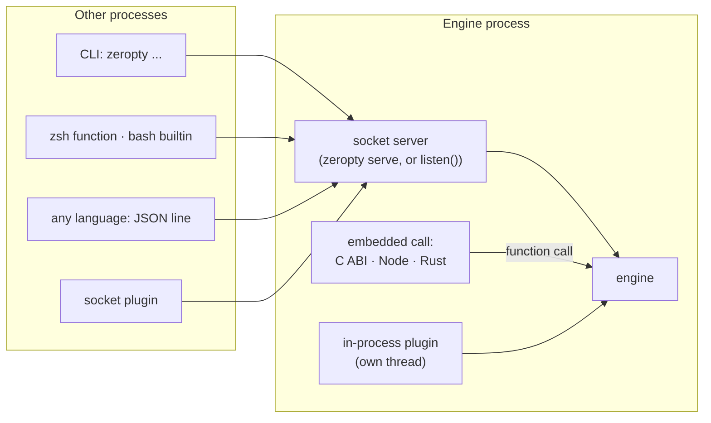

# Four ways to drive zeropty

This page compares the ways a person or a program can send commands to the zeropty engine, and the plugins that extend it. For working code, see [Use zeropty from Node.js](/guide/node), [Embed zeropty in C or Rust](/guide/embed) and [Write a plugin](/guide/plugins).



*Every path ends at the same engine (in `zeropty serve` or in your own program) and takes the same command; they differ in how many process boundaries a command crosses.*

## One command format

Every interface takes the same command: an argument list such as `["send-keys", "-t", "=work:", "Enter"]`. Every interface returns the same result: an exit `code`, `out` and `err`. Code written for one interface moves to another by changing only how the command is sent.

## The four ways

### CLI

The `zeropty` program sends one command to the server's socket and exits. You write `zeropty` where you would write `tmux`. Each call starts a process, which costs 3.68~3.92ms per `send-keys -l` from a shell script.

From inside a shell, two helpers talk to the socket without starting a process:

- **zsh function.** `source shell/zeropty.zsh` makes `zeropty` a shell function: `send-keys -l` at p50 0.12ms.
- **bash builtin.** `enable -f dist/zeropty_bash.dylib zeropty` makes it a builtin: `send-keys -l` at 0.043~0.048ms.

Both fall back to the program for `attach`, `serve`, `restart-server`, help and version, and when no server is running.

### Socket

Any language can send one line of JSON to the server socket and read one line back:

```text
→ {"argv":["capture-pane","-p","-t","=work:"],"cwd":"/"}
← {"code":0,"out":"...screen...","err":""}
```

One connection carries many commands, answered in order. `cwd` is the base for relative paths. For Node.js, `client/zeropty.mjs` keeps one connection open and opens a separate one for each `wait-pane`. For the format, see [Socket protocol](/reference/socket-protocol).

### Embedded

The **embedded** engine runs inside your process, with no server process. A command is a function call. It is available through the C ABI (application binary interface: `libzeropty_c.dylib` and `zeropty.h`, usable from any language with an FFI, or foreign function interface), a Node.js module (`client/embedded.mjs`) and a Rust crate.

The embedded engine runs in one of two modes:

| Mode | How it runs | Calls from | 400 idle sessions |
|---|---|---|---|
| **Engine thread** (`zeropty_open`, Rust `Embedded`, Node `{ polled: false }`) | The engine has its own thread | Any thread | 0.74MB |
| **Polled** (`zeropty_open_polled`, Rust `Polled`, the Node default) | Your event loop drives the engine through its fd and timeout | The loop's thread only | 0.45~0.46MB |

Three things differ from a server:

- Sessions end when your process exits. Hand them to a server first with `push-sessions` to keep them.
- `wait-pane` is not available as a function call. It works over the socket once you call `listen`, and Rust hosts can use `Engine::wait_start` and `wait_check`.
- `listen(SOCKET)` opens a socket in your process, so the CLI, `attach` and socket clients reach the same sessions. Replace `SOCKET` with a path of 103 bytes or less.

### Plugins

A **plugin** is code outside zeropty that listens to session events and adds commands. Commands a plugin adds are called like built-in ones, from every interface above.

| Way to attach | Language | Where it runs |
|---|---|---|
| Socket | Any (socket + JSON) | Its own process |
| Plugin library (`.dylib`) | C, or anything that exports C functions | A separate process via `zeropty plugin-run`, or inside the host |
| C ABI callback | C, or anything that passes C functions | The host process, on its own plugin thread |
| Rust trait | Rust | The host process, on its own plugin thread |

- **Isolation.** Each plugin runs on its own thread or in its own process. The engine keeps running when a plugin is slow, hangs or panics.
- **Access.** A plugin can only run the commands its declared access allows. The default, `read`, can only look.
- **Autostart.** If `ZEROPTY_PLUGIN_DIR` is set, the server starts the executables and `.dylib` files in that directory and restarts them when they exit, including after `restart-server`. If it is not set, nothing is run.
- **No plugins, no cost.** The output path adds one branch, and commands read one extra atomic variable.

## Comparison

`send-keys` latency from a Node.js program, p50 over three runs, with 200 busy sessions per server (Apple M1):

| Way | How a command travels | `send-keys` p50 |
|---|---|---|
| tmux CLI | Start a tmux process per command | 9.03~9.56ms |
| tmux control mode (`-C`) | One tmux client, commands on stdin | 0.42~0.49ms |
| zeropty socket | One connection, one JSON line | 0.24~0.26ms |
| zeropty embedded | Function call in the same process | 0.06~0.07ms |

Against running tmux per command, the socket is 34.7~39.8x faster and the embedded engine 128~159x. Against tmux control mode, the socket is 1.6~2.0x and embedded 6.0~8.1x. A round trip between two processes is the floor for any socket method.

## When to choose which

| You want to | Choose |
|---|---|
| Replace `tmux` in scripts, or try zeropty by hand | CLI |
| Send many commands from a shell script | zsh function or bash builtin |
| Drive sessions from a program in any language, sharing them with people and the CLI | Socket |
| The lowest latency and memory, with sessions owned by your program | Embedded (polled from an event loop, engine thread from many threads) |
| Embedded speed, but still reachable by `attach` and the CLI | Embedded plus `listen` |
| React to session events or add a command | Plugin |

## Why it works this way

- **Process start is most of a command's cost.** Even an empty C program takes 1.3ms to start. Each step down the table removes a process start or a process boundary.
- **One format keeps the choice open.** Because every interface takes the same argument list, you can start with the CLI and move to the socket or the embedded engine without rewriting commands.
- **Embedding trades lifetime for speed.** With no server, sessions live only as long as your process. `listen`, `push-sessions` and `pull-sessions` give back sharing and persistence when you need them.
- **Plugins are isolated by default.** Running each on its own thread or process, with `read` access and autostart off, keeps a faulty plugin from stopping the engine or running unasked.

## Next steps

- [Use zeropty from Node.js](/guide/node): the socket client and the embedded module.
- [Embed zeropty in C or Rust](/guide/embed): engine thread and polled mode in code.
- [Write a plugin](/guide/plugins): attach a plugin over the socket or as a `.dylib`.
- [Benchmarks](/guide/benchmarks#latency-node-benchlatencymjs-200): every latency measurement.
