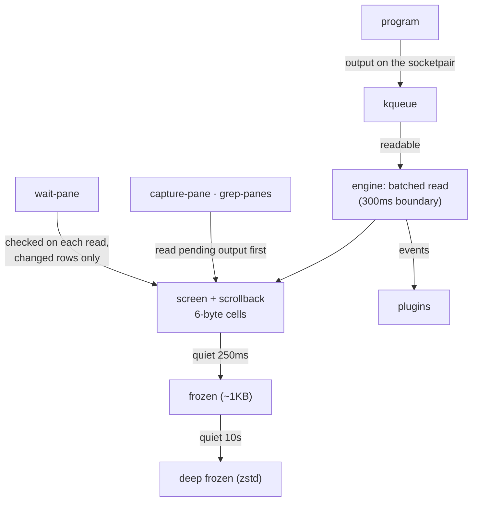

# Screens, keys and waiting

This page explains how a session's output becomes a screen, how commands read it and send keys, and how `wait-pane` knows when something happened without polling. For the steps in a script, see [Drive agents from the shell](/guide/shell).



*Output is read in batches into a compact screen; readers always process pending output first, and waiters are checked only when output arrives.*

## The screen

The engine parses each session's output with its own screen parser. Its results are compared with the [`vt100` crate](https://crates.io/crates/vt100) on recorded claude sessions and thousands of sets of random input.

```text
Cell (6 bytes, packed)
┌───────────────────────────────┬──────────────────┐
│ ch: u32                       │ attr: u16        │
│ code point + wide-char flag   │ palette index    │
│ (intern id if >1 code point)  │ (color + font)   │
└───────────────────────────────┴──────────────────┘
```

- A cell is 6 bytes; the `vt100` crate uses 32.
- A row holds cells only up to its last non-empty column, so empty space costs nothing.

### Folding quiet screens

Most sessions of an agent host sit still most of the time. The longer a screen stays quiet, the smaller the form it is kept in. Output or a read unfolds it again.

| State | When | Size |
|---|---|---|
| Expanded rows | While output is parsed | Full cells |
| Packed rows | Right after a read touches them | 1 byte per ASCII character, repeated cells stored once |
| Frozen | 250ms of quiet (`ZEROPTY_FREEZE_MS`) | The whole screen in one chunk; a claude screen is about 1KB |
| Deep frozen | 10 seconds of quiet | Compressed again with zstd, kept in an unnamed temporary file |

Set `ZEROPTY_COLD=memory` to keep deep-frozen screens in process memory instead of the file.

### Batched reads, current answers

Output is not read the moment it arrives. It is collected until a 300ms boundary (`ZEROPTY_COALESCE_MS`) and read all at once. If 16KB or more piles up, or a person is attached, it is read right away.

Batching never makes a reader see an old screen. `capture-pane`, `grep-panes` and `wait-pane` first read and parse any pending output, then answer.

## Reading the screen: capture-pane

`capture-pane` reads the screen as text, with the same options and line numbers as tmux:

```sh [Terminal]
zeropty capture-pane -p -e -S -200 -t '=work:'   # screen + 200 lines of scrollback, with colors
```

| Option | Meaning |
|---|---|
| `-p` | Print to standard output (without it, the screen goes into a buffer) |
| `-e` | Include color and font escapes |
| `-J` | Join lines that were split by wrapping |
| `-N` | Keep trailing spaces |
| `-S`, `-E` | First and last line: 0 is the first screen line, negative numbers are scrollback, `-` means to the end |

`display-message -p` prints format variables such as `#{cursor_x}`, `#{alternate_on}` and `#{history_size}`. For the full list, see [Format variables](/reference/keys-and-formats#format-variables).

## Sending keys: send-keys

`send-keys` sends each argument either as a key or as text:

```sh [Terminal]
zeropty send-keys -t '=work:' -l 'Fix the failing test'
zeropty send-keys -t '=work:' Enter
```

- An argument that is a **key name** sends that key's bytes: `Enter`, `Escape`, `Tab`, `BSpace`, `Up`, `PageUp`, `F1`~`F12` and more. Prefix `C-`, `M-` or `S-` for Ctrl, Alt or Shift (`C-c`, `M-x`, `S-Up`). Names are case-insensitive, and the bytes were checked against tmux 3.
- Anything else is sent as literal text. `-l` sends every argument literally, `-H` reads hexadecimal bytes, and `-N` repeats.
- When a program turns on application cursor mode (vim and others), arrow keys switch to the `ESC O A` form, as in tmux.

Keys then pass through the line discipline. For details, see [How a session gets a terminal](/guide/concepts/terminal#the-line-discipline).

## Waiting: wait-pane

`wait-pane` answers when something happens on a screen. tmux has no such command.

| Option | Answers when |
|---|---|
| `-m TEXT` | `TEXT` appears on the screen (at once if it is already there) |
| `-q MS` | The session has printed nothing for `MS` milliseconds |
| Both | Both hold |
| `-T MS` | Not met within `MS` milliseconds: exit code 1, `wait-pane: timed out` |

Replace `TEXT` and `MS` with your text and times. If the session ends while waiting, `wait-pane` exits with code 1 and `wait-pane: session ended`.

**How it is notified.** The engine checks a waiting session only when its output arrives, and only the rows that output changed. Waiting sessions are read immediately rather than every 300ms. So nothing polls: the host sends one request and gets one answer. Text is matched within a row, so text split by a line wrap is not found.

With 200 sessions replaying real claude work, measured on an Apple M1:

| Method | Server CPU | Host (Node) CPU | Detection latency p50 / p95 |
|---|---|---|---|
| 500ms polling | 2.0% | 0.6% | 253~262 / 479~489ms |
| 200ms polling | 2.9~3.0% | 1.1~1.3% | 86~96 / 173~196ms |
| `wait-pane` | 3.8~3.9% | 0.3~0.4% | 1 / 2ms |

::: warning Typed text matches too
Typed text is echoed to the screen. If you send `echo done` and wait for `-m done`, the typed line matches at once. Wait for text that only the result prints.
:::

## Searching every screen: grep-panes

`grep-panes TEXT` searches every session's screen and prints matches as `session: line`, sorted by session name. `-S` also searches scrollback. The exit code is 1 when nothing matches, like grep. Finding 3 marked screens among 1000 idle claude screens took 16~32ms, against 4.2~4.3 seconds for `capture-pane` per session through the CLI. `grep-panes` reads a copy of a frozen screen, so it does not unfold it.

## Events

Plugins can receive what happens to screens as **events**: `session-created`, `session-exited`, `session-renamed`, `output` (the bytes read) and `activity` (the screen changed, without copying bytes). Output events arrive with the batched reads, so quiet sessions report in units of about 300ms. `output` can drop data in a very large burst; to get every byte, use `pipe-pane`. For details, see [Four ways to drive zeropty](/guide/concepts/interfaces#plugins).

## Why it works this way

- **Most screens are quiet.** Folding them away is how quiet screens use almost no memory: 400 sessions replaying claude work took 2.66~2.70MB of server memory. The cost is a small unfold when output or a read arrives.
- **Batching saves CPU.** With 400 claude sessions, CPU was 5.2% at a 100ms read interval and 3.7% at 300ms. Reading pending output before every screen read keeps answers current.
- **Waiting costs a little CPU.** `wait-pane` raised server CPU by 0.8~1.0 percentage points over 200ms polling, because waiting sessions are read at once. In exchange, detection goes from p50 86~262ms to 1ms, and the host's polling code goes away.

## Next steps

- [Drive agents from the shell](/guide/shell): `send-keys`, `wait-pane` and `capture-pane` in a script.
- [Command reference: Waiting and searching](/reference/commands#waiting-and-searching): every option.
- [Four ways to drive zeropty](/guide/concepts/interfaces): how commands reach the engine.
