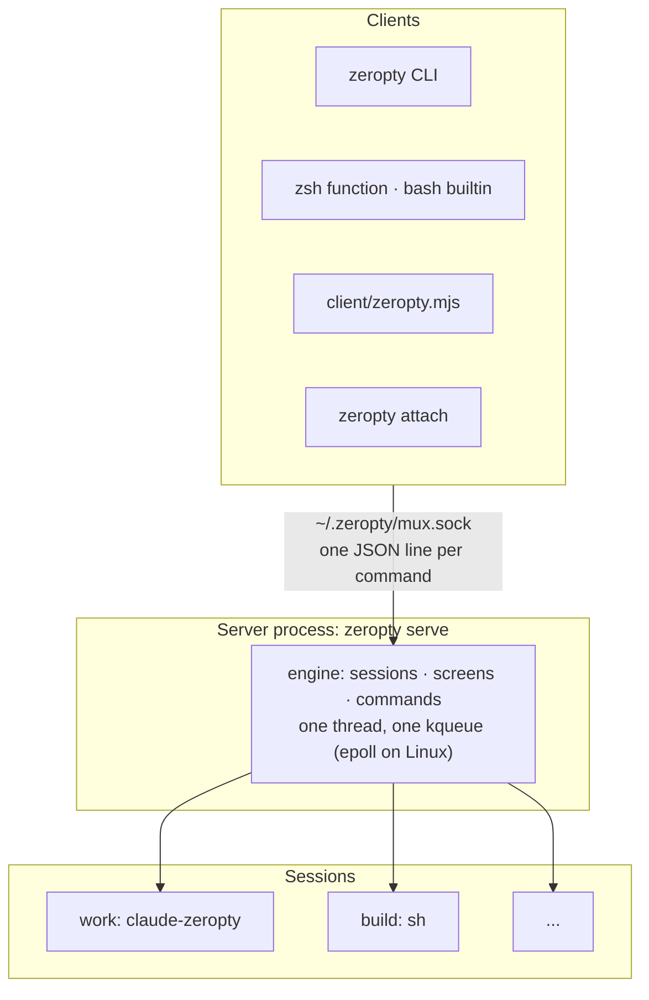

# Sessions and the server

This page explains what a session is, which process owns it, and how commands find it. For the steps to start one, see [Get started](/guide/getting-started).



*Every client talks to one server over a Unix socket, and the server's engine owns every session.*

## A session is one program

A **session** is one program and its screen. `new-session` launches a single command with `/bin/sh -c`, as its own process group. Each session has one screen and its scrollback. There are no windows or panes.

| tmux | zeropty |
|---|---|
| Session → windows → panes | Session = one program |
| One PTY per pane | No PTY; one socketpair per session |
| `split-window`, `new-window` | Not available |
| `window_index`, `pane_index` | Always `0`, for script compatibility |

Without a command, `new-session` runs `$SHELL`, or `/bin/sh` if it is unset. The default screen is 80×24, and without `-s` the name is the number of sessions created so far (`0`, `1`, ...).

The program in a session gets these variables: `TERM=xterm-256color`, `COLUMNS` and `LINES`, `ZEROPTY_SESSION` (the session name), `ZEROPTY_COLS` and `ZEROPTY_ROWS`, `ZEROPTY_SIZE_FILE` and `ZEROPTY_TTY_ID`. The last two are for the shim. `TMUX` and `TMUX_PANE` are removed, so a session started from inside tmux is not inside tmux.

## The server and its socket

The **server** is the process that runs the engine and owns every session. The `zeropty` CLI sends each command to the server's **socket**, `~/.zeropty/mux.sock` by default. Set `ZEROPTY_SOCK` to use another path, of 103 bytes or less.

- **Who starts it.** If no server is running, `new-session` starts one, just like tmux. `pull-sessions` does too. You can also start it yourself with `zeropty serve`.
- **Who can connect.** The socket has 0600 permissions, so only the same user (and root) can connect. Clients check the server the same way: the CLI and the Node clients refuse a server that runs as another user, and the server refuses a socket directory others can write.
- **One engine, one thread.** A single thread and a single kqueue (epoll on Linux) handle every session's output, process exits and timers. There is no thread or process per session.
- **Not only a separate process.** The same engine can run inside your program instead. For details, see [Four ways to drive zeropty](/guide/concepts/interfaces).

If no server answers on the socket, commands fail with `no server running on ...` and exit code 1.

### The server's environment

The server keeps the environment of the process that started it, as tmux's does. That is the first command that starts it: `new-session`, `pull-sessions` or `zeropty serve`. Later sessions get that environment, not the environment of the shell that runs each `new-session`.

| To set a variable for | Use |
|---|---|
| One new session | `new-session -e VAR=value` (repeatable) |
| Every session created afterwards | `set-environment -g VAR value` |
| Remove it for later sessions | `set-environment -g -u VAR` |

`restart-server` starts the new server from the shell that runs it. Later sessions then get that shell's environment, and values set with `set-environment -g` are dropped. Running sessions keep theirs.

## Targets

A **target** (`-t`) names one session. The forms below all mean the session `work`:

```text
=work:    =work    work    work:0
```

The name must **match exactly**. tmux also matches a prefix, so `-t wo` could reach `work`; zeropty treats that as a missing session. In scripts, write `=name:` as you would with tmux.

::: warning zsh and `=`
zsh turns `=word` into the path of a command. Quote the target, as in `-t '=work:'`. The same goes for tmux.
:::

## Scrollback

Lines that scroll off the top of the screen go into the session's scrollback. It keeps 500 lines by default; set `ZEROPTY_HISTORY` to change that. `capture-pane` reads scrollback with negative line numbers, the same numbering as tmux:

```sh [Terminal]
zeropty capture-pane -p -S -200 -t '=work:'   # the screen plus 200 lines of scrollback
```

`grep-panes -S` searches scrollback too. For details, see [Screens, keys and waiting](/guide/concepts/screens).

## When a session ends

| Event | What happens |
|---|---|
| The program exits | The session ends too, as in tmux with `remain-on-exit` off |
| `kill-session -t NAME` | SIGHUP to the session's process group; SIGKILL to anything still alive after 2 seconds |
| `kill-server` | SIGHUP to every session. A standalone server also exits; an embedded engine keeps running |
| The embedding process exits | Its sessions end with it (the programs get EOF) |
| `restart-server` | Nothing ends. A new server takes over every session and the socket |

Replace `NAME` with the session name. `restart-server` and `pull-sessions` / `push-sessions` move running sessions to another process: the programs keep running and keep their pids. For the steps, see [Move sessions and upgrade the server](/guide/moving).

## Why it works this way

- **tmux compatibility without windows.** Agent hosts already drive tmux with `new-session`, `send-keys` and `capture-pane`. Keeping those names and arguments lets you replace `tmux` with `zeropty` in most scripts. Windows and panes exist for people splitting a screen, and an agent host does not need them.
- **One program per session keeps the model flat.** A target names exactly one screen, so `-t =work:` is never ambiguous. The trade-off: you cannot split one session into several programs; start several sessions instead.
- **Exact names avoid surprises.** With prefix matching, a shortened or mistyped name can still reach some session, and keys go to an agent you did not mean. Exact matching is safer for automation, at the cost of tmux scripts that relied on prefixes.
- **The server owns the environment.** This is tmux's rule, so existing scripts behave the same. The cost is that a variable exported in your shell does not reach new sessions unless you pass it with `-e` or `set-environment -g`.

## Next steps

- [How a session gets a terminal](/guide/concepts/terminal): what replaces the PTY.
- [Command reference: Sessions](/reference/commands#sessions): every option of `new-session`, `kill-session` and the rest.
- [Environment variables](/reference/environment): `ZEROPTY_SOCK`, `ZEROPTY_HISTORY` and others.
- [Coming from tmux](/guide/from-tmux): what changes in your scripts.
