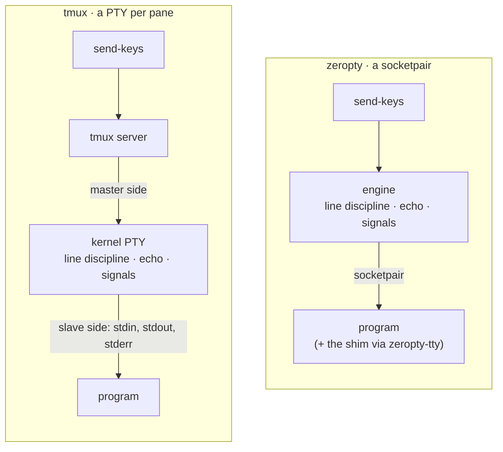

# How a session gets a terminal

This page explains what a session has in place of a PTY (pseudo-terminal), how programs that need a terminal still run, and what the engine does with the keys you send. For the steps to start vim or claude, see [Run claude and other terminal programs](/guide/terminal-programs).



*tmux leaves keys, echo and signals to a kernel PTY; zeropty does that work in the engine and talks to the program over a socketpair.*

## A socketpair instead of a PTY

Each session's terminal is a single socketpair. The program's stdin, stdout and stderr are all its one end, as they are one PTY under tmux. The engine holds the other end: it writes keys into it and reads output from it.

| | tmux | zeropty |
|---|---|---|
| Terminal per session | One kernel PTY | One socketpair |
| Session limit | macOS PTY limit: 511 by default, 999 at most | No PTY limit; 1000 sessions verified |
| PTYs used with 400 sessions | 435 | 35 (the system baseline, the same at 1000) |
| Enter, `C-c`, echo, line editing | Kernel line discipline | Emulated by the engine |
| Output buffer | PTY buffer | 64KB socket buffer per session |

Some limits still apply. macOS limits the number of processes per user (`kern.maxprocperuid`), and one claude session is about 4 processes.

## "Not a terminal"

A socket is not a terminal, so `isatty()` returns false in a session. Programs that check, such as vim, less, the python REPL and claude, then decide they are not on a terminal when launched directly. Programs that need no terminal, such as `sh`, `cat`, `python3` scripts and build commands, run as they are.

## The shim and zeropty-tty

The **shim** (`shim.dylib` on macOS, `shim.so` on Linux) is a small library loaded into the program that answers terminal calls as a terminal would. **`zeropty-tty`** is the script that starts a program with the shim injected through `DYLD_INSERT_LIBRARIES` (macOS) or `LD_PRELOAD` (Linux):

```sh [Terminal]
zeropty new-session -d -s v "dist/zeropty-tty vim notes.txt"
```

| Call the shim answers | What the program gets |
|---|---|
| `isatty` | "This is a terminal" for the session's socket |
| `tcgetattr`, `tcsetattr` | The terminal mode; a mode change is reported to the engine |
| `ioctl(TIOCGWINSZ)` | The window size, read from `ZEROPTY_SIZE_FILE` |
| `tcgetpgrp`, `tcsetpgrp` | The foreground process group; a change is reported to the engine |
| `open("/dev/tty")` | The session's socket, for reading, writing or both |
| `readpassphrase`, `getpass` | A prompt that does not echo what you type |

Only the session's own socket counts as the terminal. A program whose stdout is piped on (`zeropty-tty prog | cat`) or whose stdin is `/dev/null` sees no terminal there, just as under tmux. Outside a session, the shim answers nothing.

When a program changes the terminal mode, the shim slips that fact into the output stream as an OSC (operating system command) sequence that never reaches the screen. The engine therefore knows the exact point from which keys must be handled differently. When the window size changes, for example when a person attaches from a terminal of another size, the engine rewrites the size file and sends SIGWINCH.

### Programs the shim cannot enter

macOS does not let the shim into SIP-protected binaries, such as those in `/usr/bin`, or into binaries signed with the hardened runtime. `zeropty-tty` runs such programs from a copy with only the signature changed, kept in `~/.zeropty/tty/`, and rebuilds the copy when the original changes.

- The copy does not carry the original's privileges, so `top` and `ps` do not work this way.
- Scripts that go through `/usr/bin/env` lose the shim; start the interpreter itself with `zeropty-tty`.
- `/usr/bin` programs typed at a shell inside a session run without the shim. Start them with `zeropty-tty` when they need a terminal.

### A runtime adapter instead of the shim

A program that runs on Node or Bun can skip the shim and the copy: the runtime loads a small script before the program (`NODE_OPTIONS=--require`, `BUN_OPTIONS=--preload`), and the script makes the session's socket a terminal to the program's `tty` module and `process.stdout`/`process.stdin`. It reads `ZEROPTY_TTY_ID` and `ZEROPTY_SIZE_FILE`, follows SIGWINCH, and reports raw mode with the same OSC sequence the shim uses. The program's binary, its signature and its hardened runtime stay as they are. claude's native build is such a program. [`examples/node/tty-adapter.cjs`](https://github.com/CreatiCoding/zeropty/blob/main/examples/node/tty-adapter.cjs) is one adapter; [Run claude and other terminal programs](/guide/terminal-programs) uses it.

## The line discipline

A **line discipline** is the layer that turns typed keys into what a program reads. On a PTY the kernel does it. In zeropty the engine does it when it sends keys, and the same keys were checked against tmux. A new session starts in cooked mode, the same as a fresh PTY.

| Mode | What happens to keys |
|---|---|
| Cooked (default) | Enter becomes a newline. Input is collected line by line and can be edited with `BSpace`, `C-u`, `C-w` and `C-v`. Typed characters are echoed. `C-d` on an empty line is end of input |
| Raw (claude, vim, the python REPL, after the shim reports it) | Keys pass through unchanged |

A program without the shim can ask for raw mode by printing `\033]zeropty-tty;0\007`, the equivalent of `stty raw -echo`.

### Signals to the foreground job

In cooked mode, `C-c`, `C-\` and `C-z` go to a process group as signals. That is the session's group, or the job a shell with job control (zsh, `bash -i`) gave the terminal to. The shell's `tcsetpgrp` reaches the engine through the shim, so the shell must run with it (`zeropty-tty zsh`). The job itself may be any program, `/usr/bin` included. Only a process group with a member under the session's program is taken.

Before 0.1.5, these keys went to the shell instead of the job, so `sleep 30` typed at zsh could not be stopped. A shell started before that upgrade keeps the old shim; start it again. For details, see [Changelog](/guide/changelog).

### Differences from a PTY

- **`C-d` shuts input for good.** A socket cannot signal "EOF once", so after `C-d` on an empty line the session accepts no more input. Output still flows. Send `C-c` or the program's own quit command instead, unless you mean to end it.
- **`O_NONBLOCK` is shared.** stdin, stdout and stderr are one file, as on a PTY. A program that sets `O_NONBLOCK` on one sets it on all three, for later commands in the session too.

## Why it works this way

- **No PTY limit.** tmux opens one PTY per pane and stops at 511 by default, 999 at most. Agent hosts need hundreds to thousands of sessions, so zeropty does not use PTYs at all.
- **A socketpair, not a pipe.** Once about 250 macOS pipes have grown, the rest are stuck at 512 bytes. With 1000 sessions, 41% of the output was stuck inside the programs. A separate 64KB socket buffer per session lets everything flow. The cost: when zeropty stops reading, up to 64KB per session waits in kernel buffers (64MB for 1000 sessions).
- **The engine as line discipline.** Doing echo and signals in the engine adds about 10µs per key in cooked sessions. Raw-mode sessions such as claude get no extra work.
- **The trade-off is the shim.** Programs that need a terminal must start through `zeropty-tty`, and privileged system programs such as `top` cannot run that way. On Linux a statically linked program, such as most Go binaries, never loads the shim.

## Next steps

- [Run claude and other terminal programs](/guide/terminal-programs): the steps for vim, zsh and claude.
- [Screens, keys and waiting](/guide/concepts/screens): what happens to the output.
- [Key names](/reference/keys-and-formats#key-names): every key `send-keys` understands.
- [Design notes](/guide/design#1-sockets-instead-of-ptys): the shim and the line discipline in more depth.
