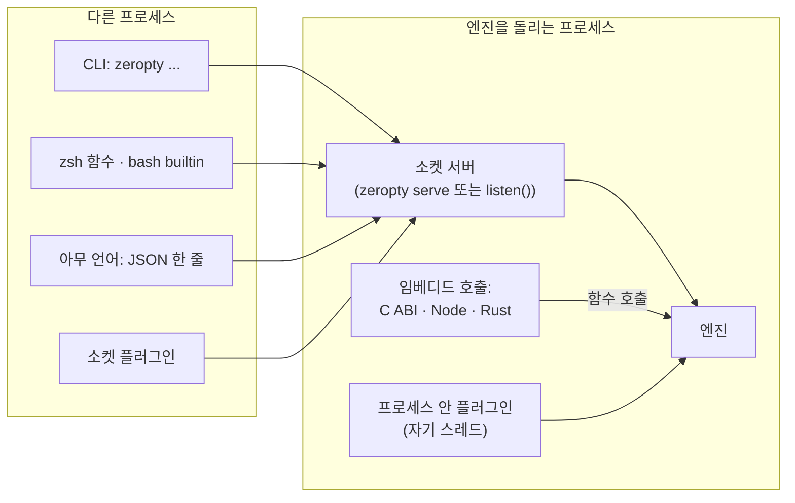

# zeropty를 다루는 네 가지 방법

이 페이지는 사람이나 프로그램이 zeropty 엔진에 명령을 보내는 방법들과, 엔진을 넓히는 플러그인을 비교해요. 돌아가는 코드는 [Node.js에서 zeropty 쓰기](/ko/guide/node), [C와 Rust에 zeropty 내장하기](/ko/guide/embed), [플러그인 작성하기](/ko/guide/plugins)를 보세요.



*어느 길이든 같은 엔진(`zeropty serve` 또는 내 프로그램 안)에 닿고 같은 명령을 받아요. 다른 점은 명령이 프로세스 경계를 몇 번 넘느냐예요.*

## 명령 형식은 하나

모든 인터페이스가 같은 명령을 받아요. `["send-keys", "-t", "=work:", "Enter"]` 같은 인자 목록이에요. 결과도 모두 같아요. 종료 `code`, `out`, `err`예요. 한 인터페이스로 쓴 코드는 명령을 보내는 방법만 바꾸면 다른 인터페이스로 옮겨요.

## 네 가지 방법

### CLI

`zeropty` 프로그램은 서버 소켓에 명령 하나를 보내고 끝나요. `tmux`를 쓰던 자리에 `zeropty`를 쓰면 돼요. 부를 때마다 프로세스가 떠서, 셸 스크립트에서 `send-keys -l` 한 번에 3.68~3.92ms가 들어요.

셸 안에서는 두 도우미가 프로세스를 띄우지 않고 소켓에 말해요.

- **zsh 함수.** `source shell/zeropty.zsh`를 하면 `zeropty`가 셸 함수가 돼요: `send-keys -l` p50 0.12ms.
- **bash builtin.** `enable -f dist/zeropty_bash.dylib zeropty`를 하면 builtin이 돼요: `send-keys -l` 0.043~0.048ms.

둘 다 `attach`, `serve`, `restart-server`, 도움말, 버전, 그리고 서버가 없을 때는 프로그램을 실행해요.

### 소켓

어떤 언어든 서버 소켓에 JSON 한 줄을 보내고 한 줄을 읽으면 돼요.

```text
→ {"argv":["capture-pane","-p","-t","=work:"],"cwd":"/"}
← {"code":0,"out":"...screen...","err":""}
```

연결 하나로 여러 명령을 보내고, 답은 순서대로 와요. `cwd`는 상대 경로의 기준이에요. Node.js에서는 `client/zeropty.mjs`가 연결 하나를 열어 두고, `wait-pane`마다 연결을 따로 열어요. 형식은 [소켓 프로토콜](/ko/reference/socket-protocol)을 보세요.

### 임베디드

**임베디드** 엔진은 서버 프로세스 없이 내 프로세스 안에서 돌아요. 명령은 함수 호출이에요. C ABI(애플리케이션 바이너리 인터페이스: `libzeropty_c.dylib`와 `zeropty.h`, FFI(외부 함수 인터페이스)가 되는 어떤 언어에서든), Node.js 모듈(`client/embedded.mjs`), Rust crate로 쓸 수 있어요.

임베디드 엔진은 두 모드 중 하나로 돌아요.

| 모드 | 어떻게 도나요 | 부를 수 있는 곳 | 대기 세션 400개 |
|---|---|---|---|
| **엔진 스레드** (`zeropty_open`, Rust `Embedded`, Node `{ polled: false }`) | 엔진이 자기 스레드를 가져요 | 어느 스레드든 | 0.74MB |
| **polled** (`zeropty_open_polled`, Rust `Polled`, Node 기본값) | 내 이벤트 루프가 엔진의 fd와 타임아웃으로 엔진을 돌려요 | 그 루프의 스레드만 | 0.45~0.46MB |

서버와 다른 점이 세 가지 있어요.

- 세션은 내 프로세스가 끝나면 함께 끝나요. 남기려면 먼저 `push-sessions`로 서버에 넘기세요.
- `wait-pane`은 함수 호출로는 쓸 수 없어요. `listen`을 부르면 소켓으로는 되고, Rust 호스트는 `Engine::wait_start`와 `wait_check`를 쓸 수 있어요.
- `listen(SOCKET)`은 내 프로세스에 소켓을 열어서, CLI, `attach`, 소켓 클라이언트가 같은 세션에 닿게 해요. `SOCKET`은 103바이트 이하의 경로로 바꾸세요.

### 플러그인

**플러그인**은 zeropty 밖의 코드로, 세션 이벤트를 듣고 명령을 더해요. 플러그인이 더한 명령은 위의 모든 인터페이스에서 내장 명령처럼 불러요.

| 붙이는 방법 | 언어 | 도는 곳 |
|---|---|---|
| 소켓 | 아무 언어 (소켓 + JSON) | 자기 프로세스 |
| 플러그인 라이브러리 (`.dylib`) | C, 또는 C 함수를 내보내는 무엇이든 | `zeropty plugin-run`으로 띄운 별도 프로세스, 또는 호스트 안 |
| C ABI 콜백 | C, 또는 C 함수를 넘기는 무엇이든 | 호스트 프로세스 안, 자기 플러그인 스레드 |
| Rust 트레이트 | Rust | 호스트 프로세스 안, 자기 플러그인 스레드 |

- **격리.** 플러그인마다 자기 스레드나 자기 프로세스에서 돌아요. 플러그인이 느리거나 멈추거나 패닉이 나도 엔진은 계속 돌아요.
- **권한.** 플러그인은 자기가 밝힌 권한이 허용하는 명령만 실행할 수 있어요. 기본값 `read`는 보기만 해요.
- **자동 시작.** `ZEROPTY_PLUGIN_DIR`이 정해져 있으면 서버가 그 디렉터리의 실행 파일과 `.dylib`를 띄우고, 끝나면 다시 띄워요. `restart-server` 뒤에도요. 정해져 있지 않으면 아무것도 실행하지 않아요.
- **플러그인이 없으면 비용도 없어요.** 출력 경로에 분기 하나가 더해지고, 명령은 원자 변수 하나를 더 읽어요.

## 비교

Node.js 프로그램에서 잰 `send-keys` 응답 시간이에요. 세 번 돌린 p50이고, 서버마다 바쁜 세션 200개(Apple M1)예요.

| 방법 | 명령이 가는 길 | `send-keys` p50 |
|---|---|---|
| tmux CLI | 명령마다 tmux 프로세스 시작 | 9.03~9.56ms |
| tmux control mode (`-C`) | tmux 클라이언트 하나, stdin으로 명령 | 0.42~0.49ms |
| zeropty 소켓 | 연결 하나, JSON 한 줄 | 0.24~0.26ms |
| zeropty 임베디드 | 같은 프로세스 안 함수 호출 | 0.06~0.07ms |

명령마다 tmux를 실행하는 것과 비교하면 소켓은 34.7~39.8배, 임베디드 엔진은 128~159배 빨라요. tmux control mode와 비교하면 소켓은 1.6~2.0배, 임베디드는 6.0~8.1배예요. 소켓을 쓰는 방법은 어느 것이든 두 프로세스 사이 왕복이 하한이에요.

## 언제 무엇을 고르나요

| 하고 싶은 일 | 고를 것 |
|---|---|
| 스크립트에서 `tmux`를 바꾸거나, 손으로 zeropty를 써 보기 | CLI |
| 셸 스크립트에서 명령을 많이 보내기 | zsh 함수 또는 bash builtin |
| 어떤 언어로든 프로그램에서 세션을 다루고, 사람·CLI와 함께 쓰기 | 소켓 |
| 응답 시간과 메모리를 가장 낮게, 세션은 내 프로그램이 가지기 | 임베디드 (이벤트 루프에서는 polled, 여러 스레드에서는 엔진 스레드) |
| 임베디드 속도에, `attach`와 CLI로도 닿게 | 임베디드 + `listen` |
| 세션 이벤트에 반응하거나 명령 더하기 | 플러그인 |

## 왜 이렇게 했나요?

- **명령 비용은 대부분 프로세스 시작이에요.** 빈 C 프로그램도 시작에 1.3ms가 걸려요. 표에서 한 칸 내려갈 때마다 프로세스 시작이나 프로세스 경계가 하나씩 빠져요.
- **형식이 하나라 선택을 미룰 수 있어요.** 모든 인터페이스가 같은 인자 목록을 받아서, CLI로 시작했다가 명령을 고쳐 쓰지 않고 소켓이나 임베디드 엔진으로 옮길 수 있어요.
- **임베딩은 수명을 내주고 속도를 얻어요.** 서버가 없으니 세션은 내 프로세스가 살아 있는 동안만 살아요. 필요하면 `listen`, `push-sessions`, `pull-sessions`로 함께 쓰기와 지속성을 되찾아요.
- **플러그인은 기본으로 격리돼요.** 플러그인마다 자기 스레드나 프로세스에서 돌고, 권한은 `read`, 자동 시작은 꺼져 있어서, 잘못된 플러그인이 엔진을 멈추거나 시키지 않은 일을 하지 못해요.

## 다음 단계

- [Node.js에서 zeropty 쓰기](/ko/guide/node): 소켓 클라이언트와 임베디드 모듈.
- [C와 Rust에 zeropty 내장하기](/ko/guide/embed): 엔진 스레드와 polled 모드를 코드로.
- [플러그인 작성하기](/ko/guide/plugins): 소켓이나 `.dylib`로 플러그인 붙이기.
- [벤치마크](/ko/guide/benchmarks#응답-속도-node-benchlatencymjs-200): 모든 응답 시간 측정값.
