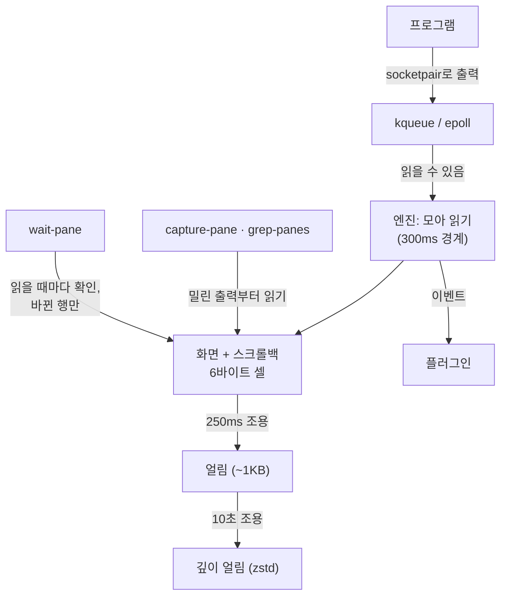

# 화면, 키, 기다리기

이 페이지는 세션의 출력이 어떻게 화면이 되는지, 명령이 화면을 읽고 키를 보내는 방법, 그리고 `wait-pane`이 폴링 없이 일이 일어난 걸 아는 방법을 설명해요. 스크립트에서 쓰는 순서는 [셸에서 에이전트 다루기](/ko/guide/shell)를 보세요.



*출력은 모아서 작은 화면 구조로 읽어요. 화면을 읽는 쪽은 늘 밀린 출력부터 처리하고, 기다리는 쪽은 출력이 올 때만 확인해요.*

## 화면

엔진은 세션마다 출력을 자체 화면 해석기로 해석해요. 녹화한 claude 세션과 무작위 입력 수천 세트로 [`vt100` crate](https://crates.io/crates/vt100)와 결과를 대조해요.

```text
Cell (6 bytes, packed)
┌───────────────────────────────┬──────────────────┐
│ ch: u32                       │ attr: u16        │
│ code point + wide-char flag   │ palette index    │
│ (intern id if >1 code point)  │ (color + font)   │
└───────────────────────────────┴──────────────────┘
```

- 셀 하나가 6바이트예요. `vt100` crate는 32바이트예요.
- 행은 마지막으로 내용이 있는 칸까지만 셀을 가져서, 빈 공간은 비용이 없어요.

### 조용한 화면 접어 두기

에이전트 호스트의 세션은 대부분 거의 늘 가만히 있어요. 화면이 오래 조용할수록 더 작은 형태로 둬요. 출력이 오거나 누가 읽으면 다시 펼쳐요.

| 상태 | 언제 | 크기 |
|---|---|---|
| 펼친 행 | 출력을 파싱하는 동안 | 셀 전체 |
| 행 압축 | 읽기가 건드린 직후 | ASCII 한 글자에 1바이트, 같은 셀 반복은 한 번만 |
| 얼림 | 250ms 조용 (`ZEROPTY_FREEZE_MS`) | 화면 통째로 한 덩어리. claude 화면은 약 1KB |
| 깊이 얼림 | 10초 조용 | zstd로 한 번 더 압축해서 이름 없는 임시 파일에 둬요 |

깊이 얼린 화면을 파일 대신 프로세스 메모리에 두려면 `ZEROPTY_COLD=memory`를 정하세요.

### 모아 읽어도 답은 최신

출력은 오자마자 읽지 않아요. 300ms 경계(`ZEROPTY_COALESCE_MS`)까지 모았다가 한 번에 읽어요. 16KB 이상 쌓이거나 사람이 붙어 있으면 바로 읽어요.

모아 읽는다고 화면을 읽는 쪽이 옛 화면을 보는 일은 없어요. `capture-pane`, `grep-panes`, `wait-pane`은 밀린 출력부터 읽고 파싱한 뒤 답해요.

## 화면 읽기: capture-pane

`capture-pane`은 tmux와 같은 옵션과 줄 번호로 화면을 텍스트로 읽어요.

```sh [터미널]
zeropty capture-pane -p -e -S -200 -t '=work:'   # screen + 200 lines of scrollback, with colors
```

| 옵션 | 뜻 |
|---|---|
| `-p` | 표준 출력으로 내요(없으면 화면이 버퍼에 들어가요) |
| `-e` | 색·글꼴 이스케이프를 포함해요 |
| `-J` | 줄바꿈으로 나뉜 줄을 이어 붙여요 |
| `-N` | 줄 끝 공백을 남겨요 |
| `-S`, `-E` | 첫 줄과 끝 줄: 0이 화면 첫 줄, 음수가 스크롤백, `-`는 끝까지 |

`display-message -p`는 `#{cursor_x}`, `#{alternate_on}`, `#{history_size}` 같은 포맷 변수를 출력해요. 전체 목록은 [포맷 변수](/ko/reference/keys-and-formats#포맷-변수)를 보세요.

## 키 보내기: send-keys

`send-keys`는 인자마다 키로 보내거나 글자로 보내요.

```sh [터미널]
zeropty send-keys -t '=work:' -l 'Fix the failing test'
zeropty send-keys -t '=work:' Enter
```

- **키 이름**인 인자는 그 키의 바이트를 보내요: `Enter`, `Escape`, `Tab`, `BSpace`, `Up`, `PageUp`, `F1`~`F12` 등이에요. Ctrl, Alt, Shift는 `C-`, `M-`, `S-`를 앞에 붙여요(`C-c`, `M-x`, `S-Up`). 이름은 대소문자를 가리지 않고, 바이트는 tmux 3과 대조했어요.
- 그 밖의 인자는 글자 그대로 보내요. `-l`은 모든 인자를 글자 그대로, `-H`는 16진수 바이트로 읽고, `-N`은 반복해요.
- 프로그램이 application cursor 모드를 켜면(vim 등) 화살표 키가 tmux처럼 `ESC O A` 형태로 바뀌어요.

그다음 키는 라인 디시플린을 거쳐요. 자세한 내용은 [세션이 터미널을 얻는 방법](/ko/guide/concepts/terminal#라인-디시플린)을 보세요.

## 기다리기: wait-pane

`wait-pane`은 화면에 무슨 일이 일어나면 답해요. tmux에는 없는 명령이에요.

| 옵션 | 답하는 때 |
|---|---|
| `-m TEXT` | `TEXT`가 화면에 나타날 때(이미 있으면 바로) |
| `-q MS` | 세션이 `MS`밀리초 동안 아무것도 출력하지 않을 때 |
| 둘 다 | 둘 다 만족할 때 |
| `-T MS` | `MS`밀리초 안에 만족하지 않으면: 종료 코드 1, `wait-pane: timed out` |

`TEXT`와 `MS`는 원하는 글자와 시간으로 바꾸세요. 기다리는 중에 세션이 끝나면 `wait-pane`은 종료 코드 1과 `wait-pane: session ended`로 끝나요.

**어떻게 알게 되나요.** 엔진은 기다리는 세션을 출력이 올 때만, 그 출력이 바꾼 행만 확인해요. 기다리는 세션은 300ms마다가 아니라 바로 읽어요. 그래서 폴링하는 곳이 없어요. 호스트는 요청 하나를 보내고 답 하나를 받아요. 글자는 행 안에서 찾아서, 줄바꿈으로 나뉜 글자는 찾지 못해요.

실제 claude 작업을 재생하는 세션 200개로 Apple M1에서 쟀어요.

| 방법 | 서버 CPU | 호스트(Node) CPU | 알아채기까지 p50 / p95 |
|---|---|---|---|
| 500ms 폴링 | 2.0% | 0.6% | 253~262 / 479~489ms |
| 200ms 폴링 | 2.9~3.0% | 1.1~1.3% | 86~96 / 173~196ms |
| `wait-pane` | 3.8~3.9% | 0.3~0.4% | 1 / 2ms |

::: warning 입력한 글자도 일치해요
입력한 글자는 화면에 에코돼요. `echo done`을 보내고 `-m done`을 기다리면 입력한 줄이 바로 일치해요. 결과에만 나오는 글자를 기다리세요.
:::

## 모든 화면 찾기: grep-panes

`grep-panes TEXT`는 모든 세션의 화면에서 찾아 `세션: 줄` 형태로, 세션 이름순으로 보여 줘요. `-S`는 스크롤백까지 찾아요. grep처럼 찾은 게 없으면 종료 코드 1이에요. 대기 중인 claude 화면 1000개에서 표시된 화면 3개를 찾는 데 16~32ms 걸렸어요. CLI로 세션마다 `capture-pane`을 하면 4.2~4.3초였어요. `grep-panes`는 얼린 화면의 사본을 읽어서 화면을 펼치지 않아요.

## 이벤트

플러그인은 화면에 일어나는 일을 **이벤트**로 받을 수 있어요: `session-created`, `session-exited`, `session-renamed`, `output`(읽은 바이트), `activity`(바이트를 복사하지 않고 화면이 바뀌었다는 것만). 출력 이벤트는 모아 읽기와 함께 오므로, 조용한 세션은 약 300ms 단위로 알려요. 아주 큰 출력이 한꺼번에 오면 `output`은 데이터를 빠뜨릴 수 있어요. 모든 바이트가 필요하면 `pipe-pane`을 쓰세요. 자세한 내용은 [zeropty를 다루는 네 가지 방법](/ko/guide/concepts/interfaces#플러그인)을 보세요.

## 왜 이렇게 했나요?

- **화면은 대부분 조용해요.** 그래서 접어 두면 조용한 화면은 메모리를 거의 쓰지 않아요. claude 작업을 재생하는 세션 400개가 서버 메모리 2.66~2.70MB를 썼어요. 대신 출력이나 읽기가 오면 조금 펼치는 비용이 들어요.
- **모아 읽으면 CPU를 아껴요.** claude 세션 400개에서 읽기 간격 100ms일 때 CPU 5.2%, 300ms일 때 3.7%였어요. 화면을 읽기 전마다 밀린 출력부터 읽어서 답은 늘 최신이에요.
- **기다리기는 CPU가 조금 들어요.** 기다리는 세션은 바로 읽기 때문에, `wait-pane`은 200ms 폴링보다 서버 CPU가 0.8~1.0%p 높았어요. 그 대신 알아채는 시간이 p50 86~262ms에서 1ms로 줄고, 호스트의 폴링 코드가 사라져요.

## 다음 단계

- [셸에서 에이전트 다루기](/ko/guide/shell): 스크립트에서 쓰는 `send-keys`, `wait-pane`, `capture-pane`.
- [명령 레퍼런스: 기다리기와 찾기](/ko/reference/commands#기다리기와-찾기): 모든 옵션.
- [zeropty를 다루는 네 가지 방법](/ko/guide/concepts/interfaces): 명령이 엔진까지 가는 길.
