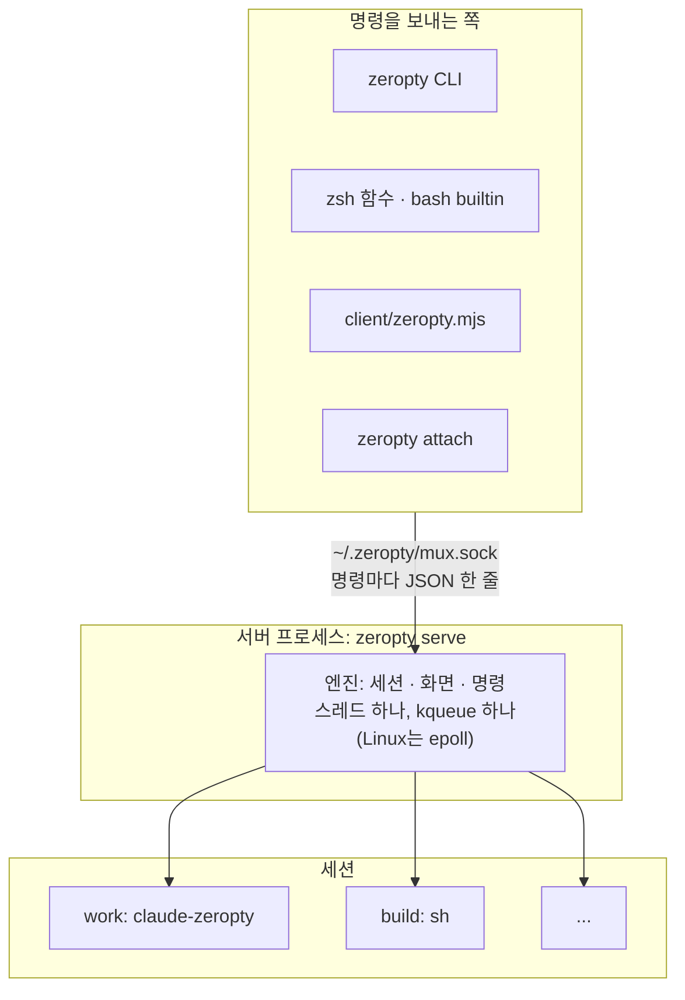

# 세션과 서버

이 페이지는 세션이 무엇인지, 어느 프로세스가 세션을 가지는지, 명령이 세션을 어떻게 찾는지 설명해요. 세션을 띄우는 순서는 [시작하기](/ko/guide/getting-started)를 보세요.



*모든 클라이언트는 Unix 소켓으로 서버 하나와 말하고, 서버의 엔진이 모든 세션을 가져요.*

## 세션은 프로그램 하나예요

**세션**은 프로그램 하나와 그 화면이에요. `new-session`은 명령 하나를 `/bin/sh -c`로, 자기 프로세스 그룹으로 띄워요. 세션마다 화면 하나와 스크롤백이 있어요. 창이나 창 분할은 없어요.

| tmux | zeropty |
|---|---|
| 세션 → 창 → 창 분할 | 세션 = 프로그램 하나 |
| 창 분할마다 PTY 하나 | PTY 없음, 세션마다 socketpair 하나 |
| `split-window`, `new-window` | 없어요 |
| `window_index`, `pane_index` | 스크립트 호환을 위해 늘 `0` |

명령이 없으면 `new-session`은 `$SHELL`을, 그게 없으면 `/bin/sh`를 돌려요. 화면 기본값은 80×24이고, `-s`가 없으면 이름은 지금까지 만든 세션 수(`0`, `1`, ...)예요.

세션의 프로그램은 이런 변수를 받아요: `TERM=xterm-256color`, `COLUMNS`와 `LINES`, `ZEROPTY_SESSION`(세션 이름), `ZEROPTY_COLS`와 `ZEROPTY_ROWS`, `ZEROPTY_SIZE_FILE`과 `ZEROPTY_TTY_ID`. 마지막 둘은 shim용이에요. `TMUX`와 `TMUX_PANE`은 지워서, tmux 안에서 띄운 세션도 tmux 안에 있지 않아요.

## 서버와 소켓

**서버**는 엔진을 돌리고 모든 세션을 가지는 프로세스예요. `zeropty` CLI는 명령마다 서버의 **소켓**에 보내요. 기본은 `~/.zeropty/mux.sock`이에요. 다른 경로를 쓰려면 `ZEROPTY_SOCK`을 103바이트 이하로 정하세요.

- **누가 띄우나요.** 돌고 있는 서버가 없으면 tmux처럼 `new-session`이 띄워요. `pull-sessions`도 그래요. `zeropty serve`로 직접 띄울 수도 있어요.
- **누가 접속할 수 있나요.** 소켓은 0600 권한이라 같은 사용자(와 root)만 접속할 수 있어요. 클라이언트도 같은 방식으로 서버를 확인해요: CLI와 Node 클라이언트는 다른 사용자로 도는 서버를 거부하고, 서버는 다른 사람이 쓸 수 있는 소켓 폴더를 거부해요.
- **엔진 하나, 스레드 하나.** 스레드 하나와 kqueue 하나(Linux는 epoll)가 모든 세션의 출력, 프로세스 종료, 타이머를 처리해요. 세션마다 스레드나 프로세스를 두지 않아요.
- **꼭 별도 프로세스일 필요는 없어요.** 같은 엔진을 내 프로그램 안에서 돌릴 수도 있어요. 자세한 내용은 [zeropty를 다루는 네 가지 방법](/ko/guide/concepts/interfaces)을 보세요.

소켓에서 답하는 서버가 없으면 명령은 `no server running on ...`과 종료 코드 1로 실패해요.

### 서버의 환경

서버는 tmux처럼 자신을 띄운 프로세스의 환경을 그대로 가져요. 서버를 띄우는 첫 명령, 즉 `new-session`, `pull-sessions`, `zeropty serve` 중 하나예요. 이후 세션은 `new-session`을 실행한 셸의 환경이 아니라 그 환경을 받아요.

| 변수를 줄 곳 | 쓰는 것 |
|---|---|
| 새 세션 하나 | `new-session -e VAR=value` (여러 번 쓸 수 있어요) |
| 이후에 만드는 모든 세션 | `set-environment -g VAR value` |
| 이후 세션에서 지우기 | `set-environment -g -u VAR` |

`restart-server`는 자신을 실행한 셸에서 새 서버를 띄워요. 그러면 이후 세션은 그 셸의 환경을 받고, `set-environment -g`로 정한 값은 사라져요. 실행 중인 세션은 자기 환경을 그대로 가져요.

## 타깃

**타깃**(`-t`)은 세션 하나를 가리켜요. 아래 형태는 모두 세션 `work`예요.

```text
=work:    =work    work    work:0
```

이름은 **정확히 일치**해야 해요. tmux는 앞부분 일치도 해서 `-t wo`로 `work`에 닿을 수 있지만, zeropty는 없는 세션으로 다뤄요. 스크립트에서는 tmux에서처럼 `=name:`으로 쓰세요.

::: warning zsh와 `=`
zsh는 `=word`를 명령 경로로 바꿔요. `-t '=work:'`처럼 타깃을 따옴표로 감싸세요. tmux도 같아요.
:::

## 스크롤백

화면 위로 밀려난 줄은 세션의 스크롤백에 들어가요. 기본으로 500줄을 남기고, `ZEROPTY_HISTORY`로 바꿔요. `capture-pane`은 tmux와 같은 번호 매김으로, 음수 줄 번호로 스크롤백을 읽어요.

```sh [터미널]
zeropty capture-pane -p -S -200 -t '=work:'   # the screen plus 200 lines of scrollback
```

`grep-panes -S`도 스크롤백까지 찾아요. 자세한 내용은 [화면, 키, 기다리기](/ko/guide/concepts/screens)를 보세요.

## 세션이 끝날 때

| 일 | 어떻게 되나요 |
|---|---|
| 프로그램이 끝나요 | tmux에서 `remain-on-exit`가 꺼져 있을 때처럼 세션도 끝나요 |
| `kill-session -t NAME` | 세션의 프로세스 그룹에 SIGHUP, 2초 뒤에도 살아 있으면 SIGKILL |
| `kill-server` | 모든 세션에 SIGHUP. 독립 서버는 함께 끝나고, 임베디드 엔진은 계속 돌아요 |
| 엔진을 넣은 프로세스가 끝나요 | 그 세션들도 함께 끝나요(프로그램들은 EOF를 받아요) |
| `restart-server` | 아무것도 끝나지 않아요. 새 서버가 모든 세션과 소켓을 넘겨받아요 |

`NAME`은 세션 이름으로 바꾸세요. `restart-server`와 `pull-sessions` / `push-sessions`는 실행 중인 세션을 다른 프로세스로 옮겨요. 프로그램은 계속 돌고 pid도 그대로예요. 순서는 [세션 옮기기와 서버 업그레이드](/ko/guide/moving)를 보세요.

## 왜 이렇게 했나요?

- **창 없는 tmux 호환.** 에이전트 호스트는 이미 `new-session`, `send-keys`, `capture-pane`으로 tmux를 다뤄요. 이 이름과 인자를 지켜서 대부분의 스크립트에서 `tmux`를 `zeropty`로 바꾸기만 하면 돼요. 창과 창 분할은 사람이 화면을 나눠 쓰려고 있는 것이라 에이전트 호스트에는 필요 없어요.
- **세션 하나에 프로그램 하나라 구조가 단순해요.** 타깃은 정확히 화면 하나를 가리켜서 `-t =work:`가 모호할 일이 없어요. 대신 세션 하나를 여러 프로그램으로 나눌 수는 없어요. 세션을 여러 개 띄우세요.
- **정확한 이름이라 뜻밖의 일이 없어요.** 앞부분 일치를 하면 줄이거나 잘못 친 이름도 어떤 세션에 닿아서, 의도하지 않은 에이전트에 키가 갈 수 있어요. 자동화에는 정확히 일치하는 편이 안전해요. 대신 앞부분 일치에 기대던 tmux 스크립트는 고쳐야 해요.
- **환경은 서버가 가져요.** tmux의 규칙이라 기존 스크립트가 똑같이 동작해요. 대신 셸에서 export한 변수는 `-e`나 `set-environment -g`로 넘기지 않으면 새 세션에 닿지 않아요.

## 다음 단계

- [세션이 터미널을 얻는 방법](/ko/guide/concepts/terminal): PTY를 무엇이 대신하는지.
- [명령 레퍼런스: 세션](/ko/reference/commands#세션): `new-session`, `kill-session` 등의 모든 옵션.
- [환경변수](/ko/reference/environment): `ZEROPTY_SOCK`, `ZEROPTY_HISTORY` 등.
- [tmux에서 넘어오기](/ko/guide/from-tmux): 스크립트에서 무엇이 달라지는지.
