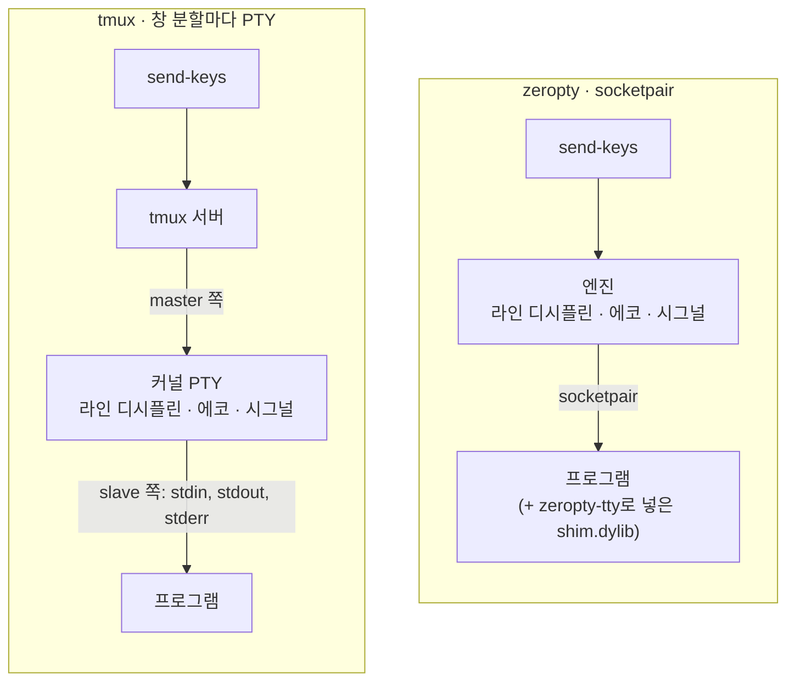

# 세션이 터미널을 얻는 방법

이 페이지는 세션이 PTY(가상 터미널) 대신 무엇을 가지는지, 터미널이 필요한 프로그램이 어떻게 그래도 돌아가는지, 보낸 키를 엔진이 어떻게 다루는지 설명해요. vim이나 claude를 띄우는 순서는 [claude와 다른 터미널 프로그램 실행하기](/ko/guide/terminal-programs)를 보세요.



*tmux는 키, 에코, 시그널을 커널 PTY에 맡기고, zeropty는 그 일을 엔진에서 하고 socketpair로 프로그램과 말해요.*

## PTY 대신 socketpair

세션마다 터미널은 socketpair 하나예요. 프로그램의 stdin, stdout, stderr가 모두 그 한쪽 끝이에요. tmux에서 PTY 하나인 것처럼요. 다른 쪽 끝은 엔진이 가지고, 거기에 키를 쓰고 출력을 읽어요.

| | tmux | zeropty |
|---|---|---|
| 세션마다 터미널 | 커널 PTY 하나 | socketpair 하나 |
| 세션 한도 | macOS PTY 한도: 기본 511개, 최대 999개 | PTY 한도 없음, 세션 1000개 확인 |
| 세션 400개일 때 쓰는 PTY | 435개 | 35개 (시스템 기본값, 1000개에서도 같아요) |
| Enter, `C-c`, 에코, 줄 편집 | 커널 라인 디시플린 | 엔진이 흉내 내요 |
| 출력 버퍼 | PTY 버퍼 | 세션마다 64KB 소켓 버퍼 |

남는 한도도 있어요. macOS는 사용자당 프로세스 수(`kern.maxprocperuid`)를 제한하고, claude 세션 하나는 프로세스가 4개쯤이에요.

## "터미널이 아니에요"

소켓은 터미널이 아니라서 세션 안에서 `isatty()`는 false를 돌려줘요. vim, less, python REPL, claude처럼 이걸 확인하는 프로그램은 그냥 띄우면 터미널이 아니라고 판단해요. `sh`, `cat`, `python3` 스크립트, 빌드 명령처럼 터미널이 없어도 되는 프로그램은 그대로 돌아요.

## shim과 zeropty-tty

**shim**(`shim.dylib`)은 프로그램 안에 들어가 터미널 호출에 터미널처럼 답하는 작은 라이브러리예요. **`zeropty-tty`**는 `DYLD_INSERT_LIBRARIES`로 shim을 넣어 프로그램을 띄우는 스크립트예요.

```sh [터미널]
zeropty new-session -d -s v "dist/zeropty-tty vim notes.txt"
```

| shim이 답하는 호출 | 프로그램이 받는 것 |
|---|---|
| `isatty` | 세션의 소켓에 대해 "터미널이에요" |
| `tcgetattr`, `tcsetattr` | 터미널 모드. 모드가 바뀌면 엔진에 알려요 |
| `ioctl(TIOCGWINSZ)` | `ZEROPTY_SIZE_FILE`에서 읽은 창 크기 |
| `tcgetpgrp`, `tcsetpgrp` | 포그라운드 프로세스 그룹. 바뀌면 엔진에 알려요 |
| `open("/dev/tty")` | 세션의 소켓. 읽기, 쓰기, 둘 다 돼요 |
| `readpassphrase`, `getpass` | 친 내용을 에코하지 않는 입력 프롬프트 |

터미널로 치는 건 세션 자신의 소켓뿐이에요. stdout을 파이프로 넘기거나(`zeropty-tty prog | cat`) stdin이 `/dev/null`인 프로그램은 tmux에서처럼 거기서 터미널을 보지 못해요. 세션 밖에서는 shim이 아무것도 답하지 않아요.

프로그램이 터미널 모드를 바꾸면, shim이 그 사실을 화면에는 나오지 않는 OSC(operating system command) 시퀀스로 출력 안에 끼워 보내요. 그래서 엔진은 키를 다르게 다뤄야 하는 정확한 지점을 알아요. 사람이 다른 크기의 터미널로 붙을 때처럼 창 크기가 바뀌면, 엔진이 크기 파일을 다시 쓰고 SIGWINCH를 보내요.

### shim이 들어가지 못하는 프로그램

macOS는 `/usr/bin` 같은 SIP 보호 바이너리와 hardened runtime 서명 바이너리에 shim을 넣지 못하게 해요. 그래서 `zeropty-tty`는 이런 프로그램을 서명만 바꾼 사본으로 실행해요. 사본은 `~/.zeropty/tty/`에 두고, 원본이 바뀌면 다시 만들어요.

- 사본에는 원본의 권한이 없어서 `top`, `ps`는 이렇게 돌릴 수 없어요.
- `/usr/bin/env`를 거치는 스크립트는 shim을 잃어요. 인터프리터를 직접 `zeropty-tty`로 띄우세요.
- 세션 안 셸에서 친 `/usr/bin` 프로그램은 shim 없이 돌아요. 터미널이 필요하면 `zeropty-tty`로 띄우세요.

### claude-zeropty

`claude-zeropty`는 `zeropty-tty claude`를 실행하는 작은 래퍼예요. `PATH`에 있는 `claude`를 써요. 다른 claude를 쓰려면 `ZEROPTY_CLAUDE_REAL`을 정하세요.

## 라인 디시플린

**라인 디시플린**은 입력한 키를 프로그램이 읽는 내용으로 바꾸는 층이에요. PTY에서는 커널이 해요. zeropty에서는 엔진이 키를 보낼 때 하고, 같은 키를 tmux와 대조했어요. 새 세션은 새 PTY와 같은 cooked 모드로 시작해요.

| 모드 | 키가 어떻게 되나요 |
|---|---|
| cooked (기본값) | Enter가 줄바꿈이 돼요. 입력을 줄 단위로 모으고 `BSpace`, `C-u`, `C-w`, `C-v`로 편집할 수 있어요. 입력한 글자가 에코돼요. 빈 줄의 `C-d`는 입력 끝이에요 |
| raw (claude, vim, python REPL, shim이 알려 준 뒤) | 키가 그대로 가요 |

shim 없는 프로그램이 raw 모드를 원하면 `\033]zeropty-tty;0\007`을 출력하면 돼요. `stty raw -echo`에 해당해요.

### 포그라운드 작업에 가는 시그널

cooked 모드에서 `C-c`, `C-\`, `C-z`는 프로세스 그룹에 시그널로 가요. 세션의 그룹이거나, job control이 있는 셸(zsh, `bash -i`)이 터미널을 넘겨준 작업의 그룹이에요. 셸의 `tcsetpgrp`는 shim을 거쳐 엔진에 전달되므로 셸은 shim과 함께 돌아야 해요(`zeropty-tty zsh`). 작업 자체는 `/usr/bin` 프로그램을 포함해 어떤 프로그램이든 돼요. 세션 프로그램 아래에 멤버가 있는 프로세스 그룹만 받아들여요.

0.1.5 전에는 이 키들이 작업이 아니라 셸로 가서, zsh에서 친 `sleep 30`을 멈출 수 없었어요. 업그레이드 전에 띄운 셸은 예전 shim을 그대로 가지고 있으니 다시 띄우세요. 자세한 내용은 [변경 기록](/ko/guide/changelog)을 보세요.

### PTY와 다른 점

- **`C-d`는 입력을 아예 닫아요.** 소켓에는 EOF를 한 번만 알리는 방법이 없어서, 빈 줄에서 `C-d`를 보내면 그 뒤로 세션은 입력을 받지 않아요. 출력은 계속 나와요. 끝낼 생각이 아니라면 `C-c`나 프로그램 자체의 종료 명령을 보내세요.
- **`O_NONBLOCK`이 함께 걸려요.** PTY처럼 stdin, stdout, stderr가 파일 하나예요. 프로그램이 그중 하나에 `O_NONBLOCK`을 걸면 셋 모두에, 세션에서 그 뒤에 실행하는 명령에도 걸려요.

## 왜 이렇게 했나요?

- **PTY 한도가 없어요.** tmux는 창 분할마다 PTY를 하나씩 열어서 기본 511개, 최대 999개에서 멈춰요. 에이전트 호스트에는 세션이 수백~수천 개 필요해서 zeropty는 PTY를 아예 쓰지 않아요.
- **파이프가 아니라 socketpair.** macOS 파이프는 약 250개가 커지면 나머지가 512바이트로 묶여요. 세션 1000개에서 출력의 41%가 프로그램 안에 묶여 있었어요. 세션마다 64KB 소켓 버퍼를 따로 주자 다 흘러요. 대신 zeropty가 읽지 않는 동안 세션마다 최대 64KB가 커널 버퍼에 기다려요(1000개면 64MB).
- **엔진이 라인 디시플린을 맡아요.** 에코와 시그널을 엔진에서 하면 cooked 세션에서 키마다 10µs쯤 더 들어요. claude 같은 raw 모드 세션에는 추가 작업이 없어요.
- **대가는 shim이에요.** 터미널이 필요한 프로그램은 `zeropty-tty`로 띄워야 하고, `top` 같은 권한 있는 시스템 프로그램은 그렇게 돌릴 수 없어요. shim 때문에 zeropty는 macOS(`DYLD_INSERT_LIBRARIES`)에 묶이기도 해요.

## 다음 단계

- [claude와 다른 터미널 프로그램 실행하기](/ko/guide/terminal-programs): vim, zsh, claude를 띄우는 순서.
- [화면, 키, 기다리기](/ko/guide/concepts/screens): 출력이 어떻게 되는지.
- [키 이름](/ko/reference/keys-and-formats#키-이름): `send-keys`가 아는 모든 키.
- [설계](/ko/guide/design#1-pty-대신-소켓): shim과 라인 디시플린을 더 깊이.
